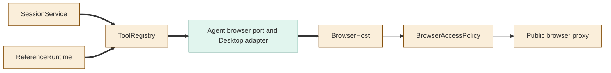
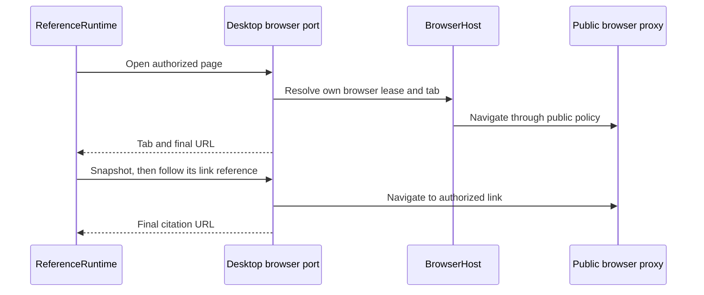
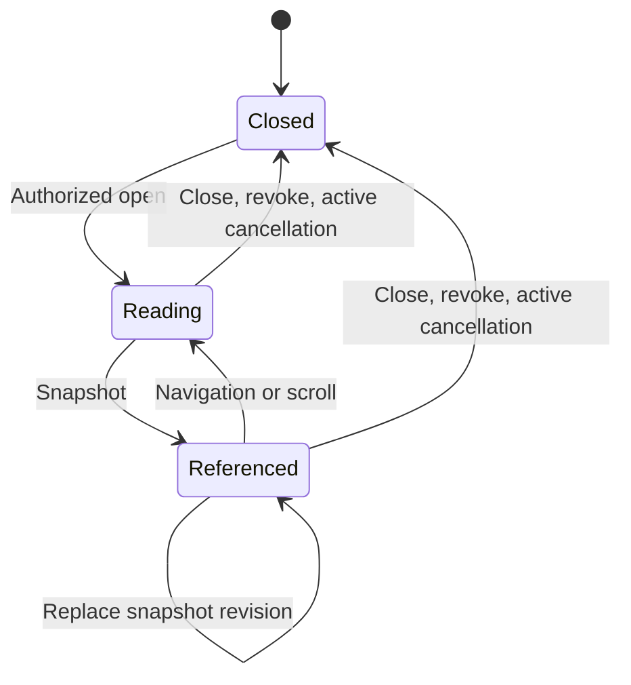

# TASK-30c92716 diagrams

Illustrates the Design in TASK-30c92716.md.

## Structure

New: agent browser port and Desktop adapter. Changed: SessionService,
ToolRegistry and ReferenceRuntime. Changed in build: BrowserHost (close signal), policy (grant signal) and proxy (document refusal).

## Sequence

## State

