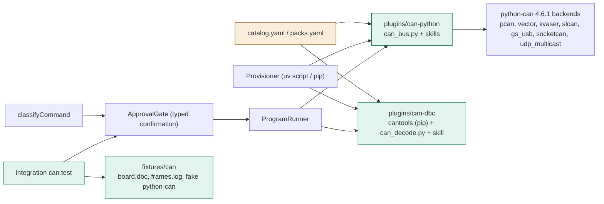
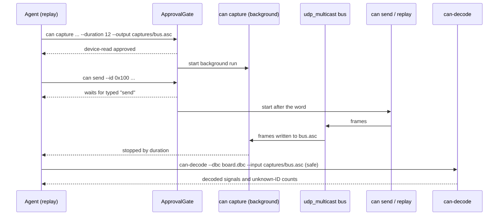

# TASK-324b8162 diagrams

Illustrates `## Design` in `TASK-324b8162.md`. The Design text is authoritative.

Node map: added = can-python package (can_bus.py), can-dbc package (cantools pip, can_decode.py), CAN fixtures,
integration test; changed = catalog.yaml/packs.yaml; unchanged = Provisioner, ProgramRunner, ApprovalGate, rule matcher.

## Structure

## Sequence

## State

Not drawn: no new lifecycle; background runs reuse the existing run states.
