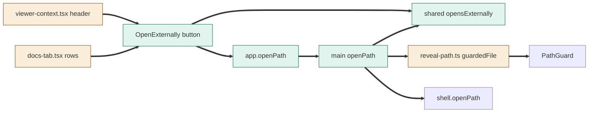
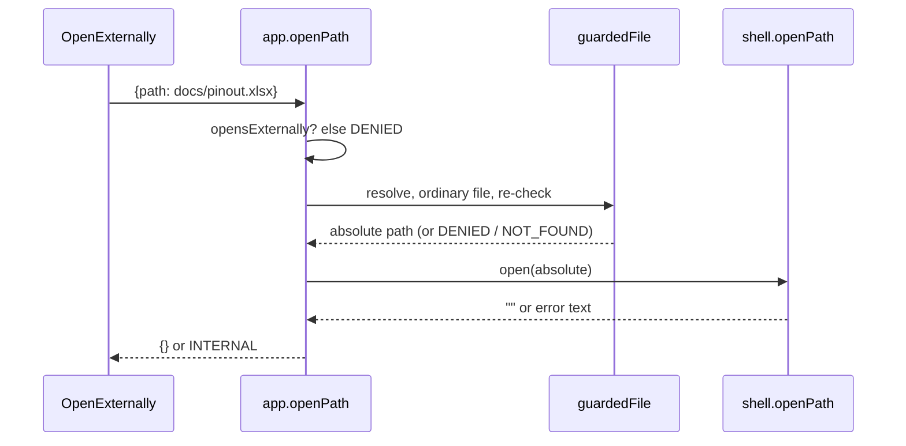

# TASK-32aa9015 diagrams

Illustrates `## Design` in `TASK-32aa9015.md`. The Design text is authoritative.

Node classes (from the Design):

| Node | Class |
|---|---|
| shared externalDocumentExtensions / opensExternally | added |
| app.openPath channel, main openPath, OpenExternally button | added |
| reveal-path.ts (guardedFile factored out), main index.ts, viewer-context.tsx, docs-tab.tsx | changed |
| PathGuard, shell.openPath | unchanged (reused) |

## Structure

## Sequence

## State

Not drawn: no lifecycle or stored state.
