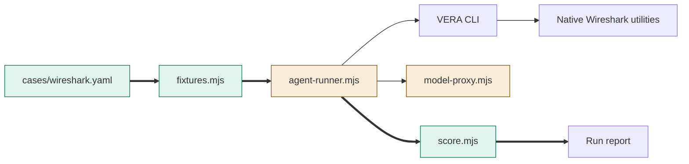
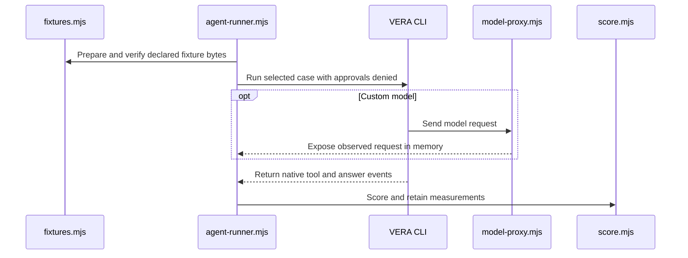

# TASK-3416fe29 diagrams

Illustrates the task journal's design.

## Structure

Added: Wireshark cases, fixture preparation, scorer. Changed: shared agent runner and model proxy. Reused: VERA CLI, native utilities, run report.

## Sequence

## State

No new lifecycle or status states are introduced.
