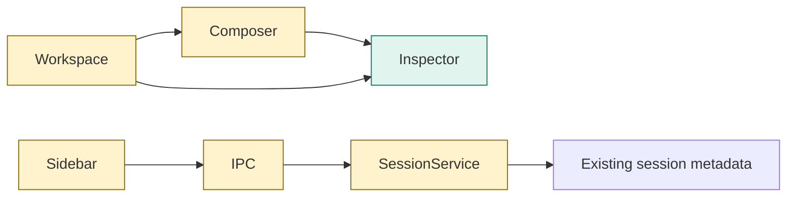
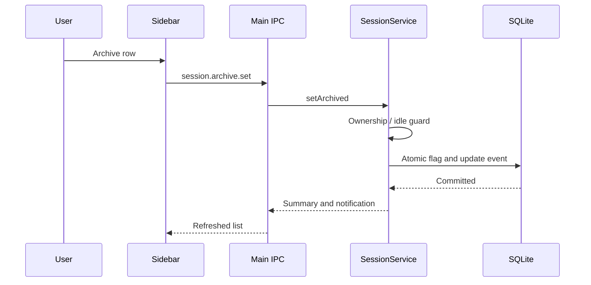
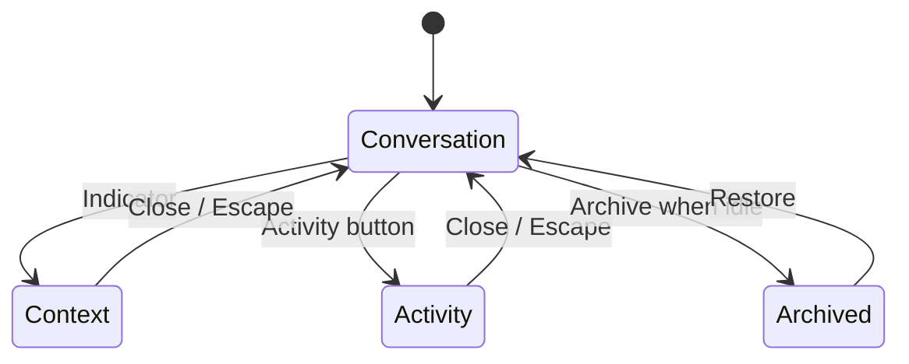

# TASK-34a0efbd diagrams

Illustrates Design in TASK-34a0efbd.md. Design is authoritative.

## Structure
Map: Workspace, Composer, Sidebar, SessionService changed; Inspector added; shared IPC changed; DB reused.

## Sequence

## State

