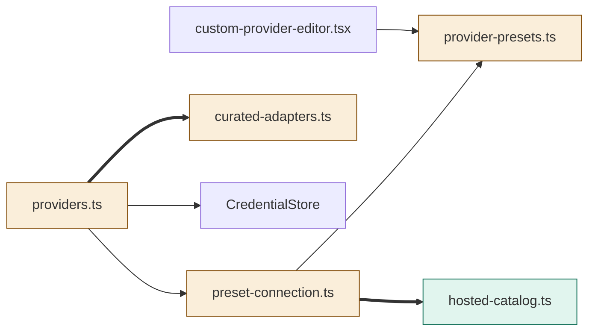
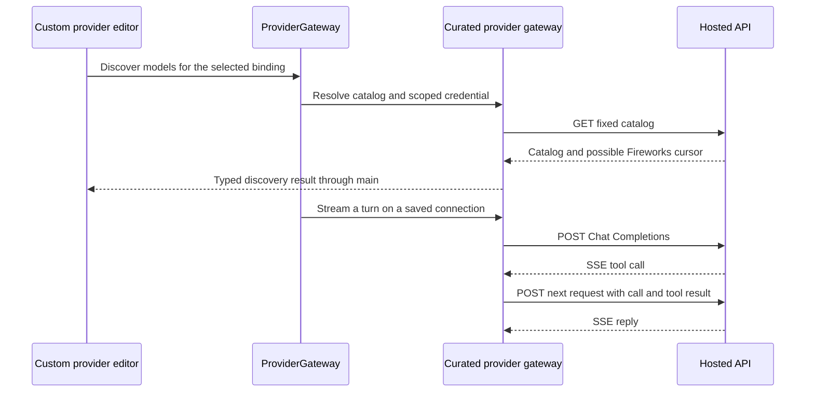

# TASK-35af2ea8 diagrams

Illustrates the task journal's Design.

## Structure

Added: hosted-catalog.ts. Changed: provider-presets.ts, preset-connection.ts, providers.ts and curated-adapters.ts. Reused: the Settings editor and the curated credential store.

## Sequence

## State

No new lifecycle or state transition.
