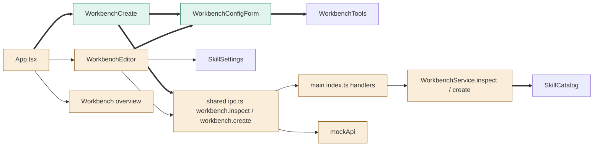
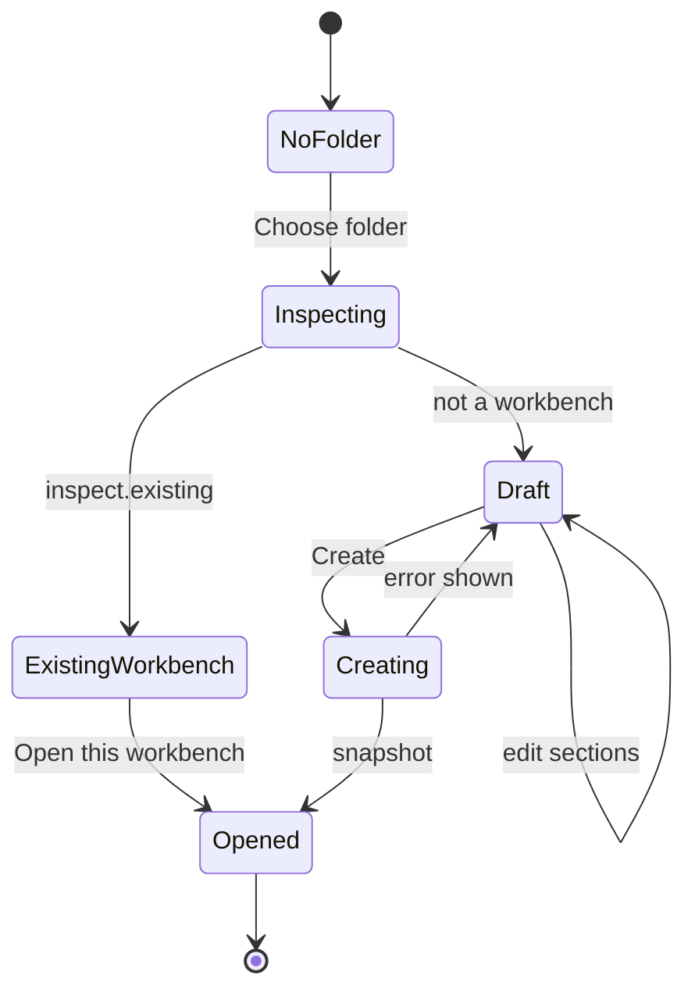

# TASK-37222751 diagrams

Illustrates `## Design` in `TASK-37222751.md`. The Design text is authoritative. Drawn after the task closed, at the user's request to use diagrams.

Node classes (from the Design):

| Node | Class |
|---|---|
| WorkbenchConfigForm, WorkbenchCreate, workbench.inspect channel, WorkbenchService.inspect | added |
| WorkbenchEditor (inline page), Workbench (overview only), App.tsx, workbench.create channel, WorkbenchService.create, main index.ts, mockApi | changed |
| SkillSettings, WorkbenchTools, PermissionPicker, SkillCatalog | unchanged |

## Structure



## Sequence

```mermaid
sequenceDiagram
    actor Engineer
    participant Create as WorkbenchCreate
    participant Main as main index.ts
    participant Service as WorkbenchService
    participant Disk as workbench folder
    Engineer->>Create: Choose folder
    Create->>Main: app.chooseFolder
    Main-->>Create: folder
    Create->>Main: workbench.inspect {folder}
    Main->>Service: inspect(folder)
    Service->>Disk: read .vera/WORKBENCH.md and skills (no writes)
    Service-->>Create: folder, name, existing, instructions, skills
    Engineer->>Create: edit draft sections, Create
    Create->>Main: workbench.create {folder, name, config, instructions}
    Main->>Service: create(folder, name, initial)
    Service->>Service: merge and validate draft (INVALID before any write)
    Service->>Disk: write workbench.yaml, WORKBENCH.md unless it exists
    Service-->>Create: snapshot of the opened workbench
```

## State


