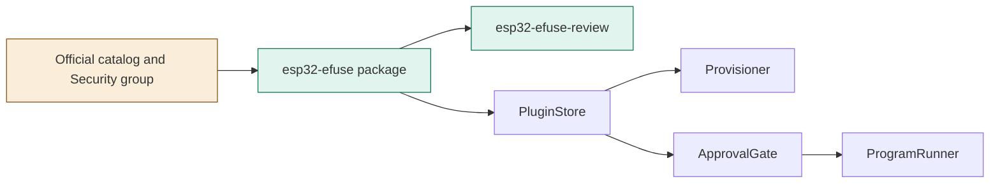
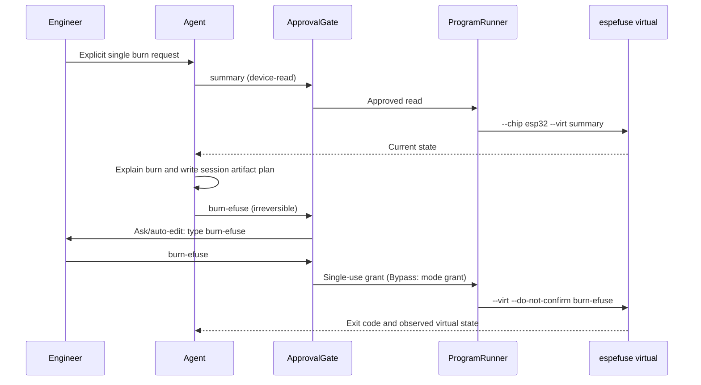

# TASK-389f3ff4 diagrams

Illustrates Design in TASK-389f3ff4.md. The Design text is authoritative.

## Structure

Node map: package and skill added; catalog changed; store, provisioner, runner, gate reused unchanged.

## Sequence

## State

Not drawn: no lifecycle or transition changes; existing approval and runner state machines are reused.
