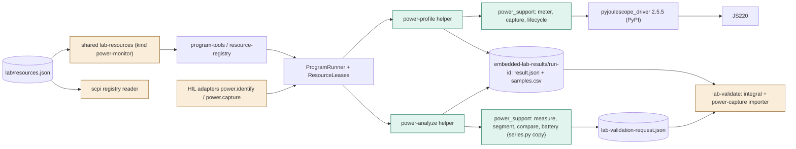
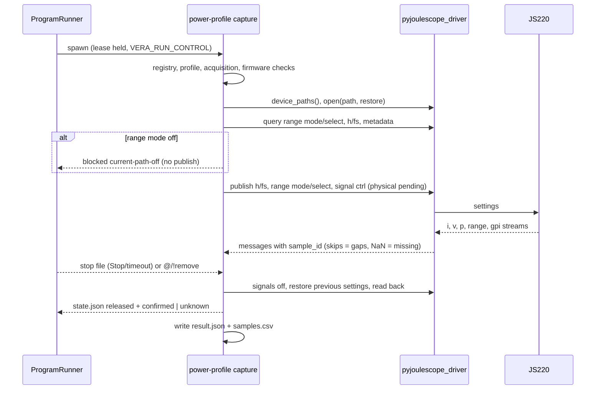
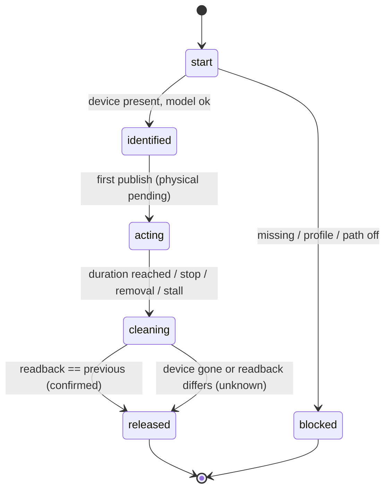

# TASK-39da0f51 diagrams

Illustrates `## Design` in `TASK-39da0f51.md`. The Design text is authoritative.

Node classes: added - power-profiler package (power-profile and power-analyze helpers, power_support modules,
profile); changed - shared lab-resources (kind power-monitor), lab-validation (integral metric, power-capture
importer, units C/J), HIL adapters/compile/executor (power steps, captures flag), scpi registry reader (skips
power-monitor entries); unchanged - program-tools / resource-registry, ProgramRunner and ResourceLeases.

## Structure

## Sequence

## State

