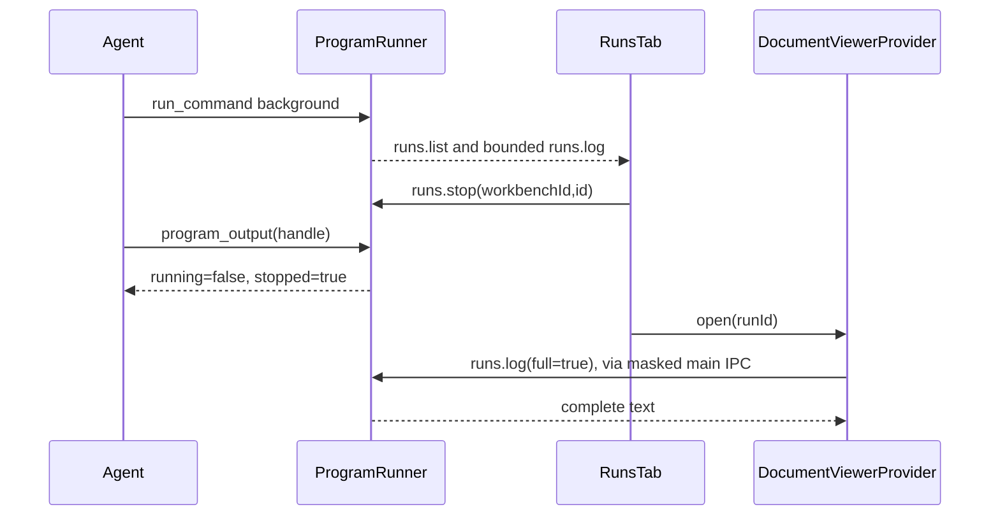

# TASK-3a2872cc diagrams

Illustrates the task Design. Map: command tool, runner records, Runs, run IPC and viewer provider are changed; text viewer is reused unchanged.

## Structure

## Sequence

## State

Not drawn: existing run lifecycle is unchanged; stopped reads expose the existing final state.
