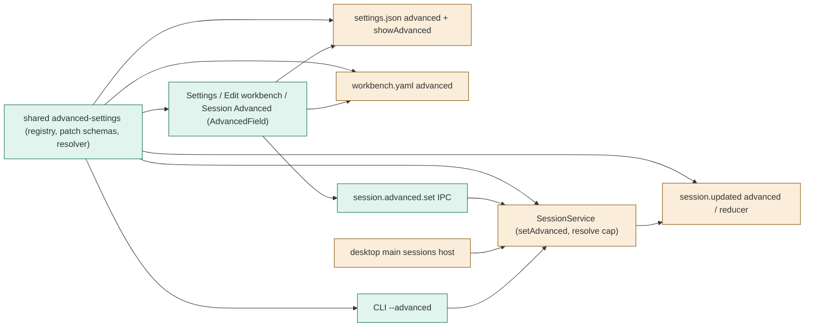
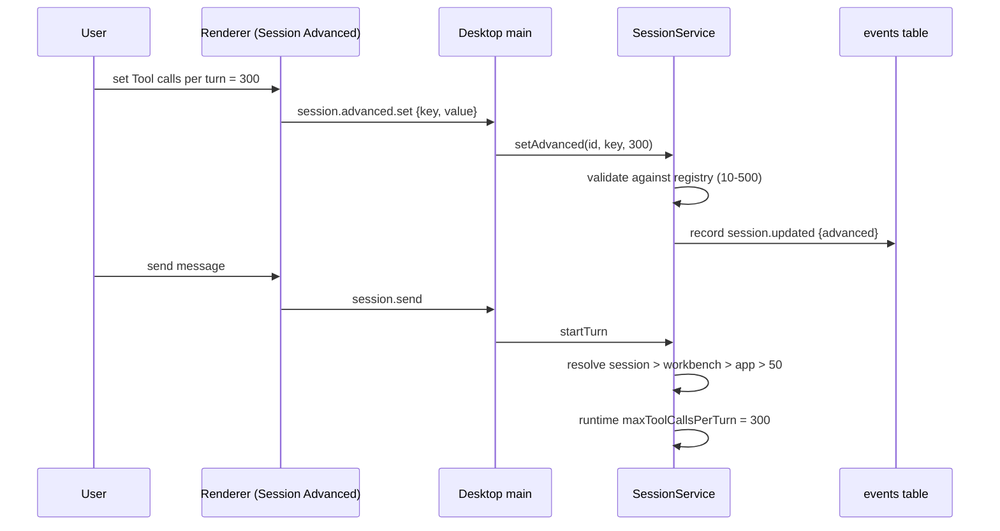
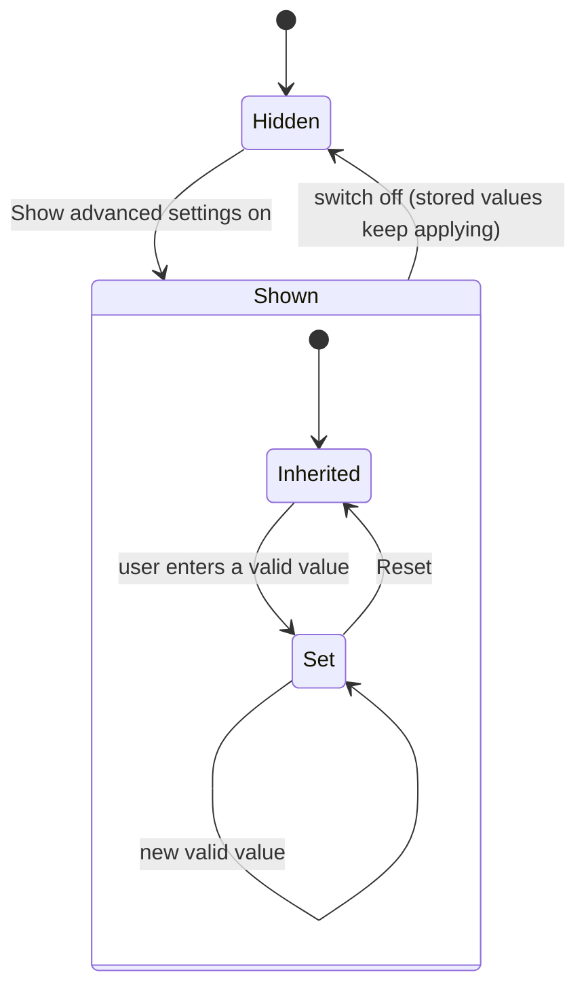

# TASK-3b687699 diagrams

Illustrates `## Design` in `TASK-3b687699.md`. The Design text is authoritative.

Node classes: added = registry/resolver, AdvancedField, Settings Advanced, Workbench Advanced, Session Advanced dialog, session.advanced.set, CLI --advanced; changed = settings.json schema, workbench.yaml schema, session.updated/reducer, SessionService, desktop main sessions host, CLI run.

## Structure

## Sequence

## State

