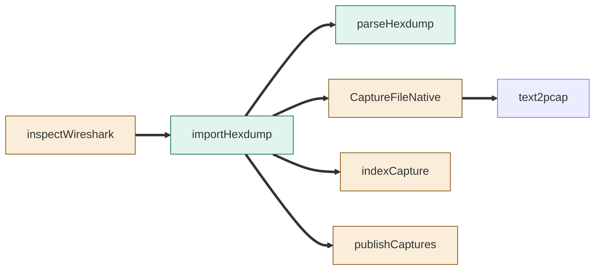
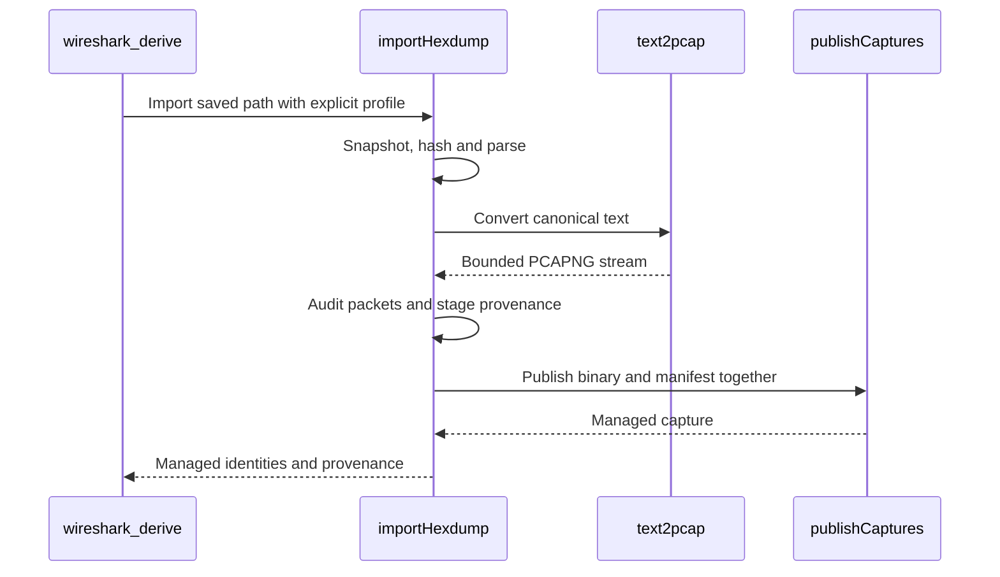

# TASK-3b8e772d diagrams

Illustrates the Design in TASK-3b8e772d.md.

## Structure

Changed: `inspectWireshark`, `CaptureFileNative`, `indexCapture`, `publishCaptures`.
Added: `importHexdump`, `parseHexdump`. Reused: text2pcap.

## Sequence

## State

Not drawn: the operation has no new persistent lifecycle or status field.
