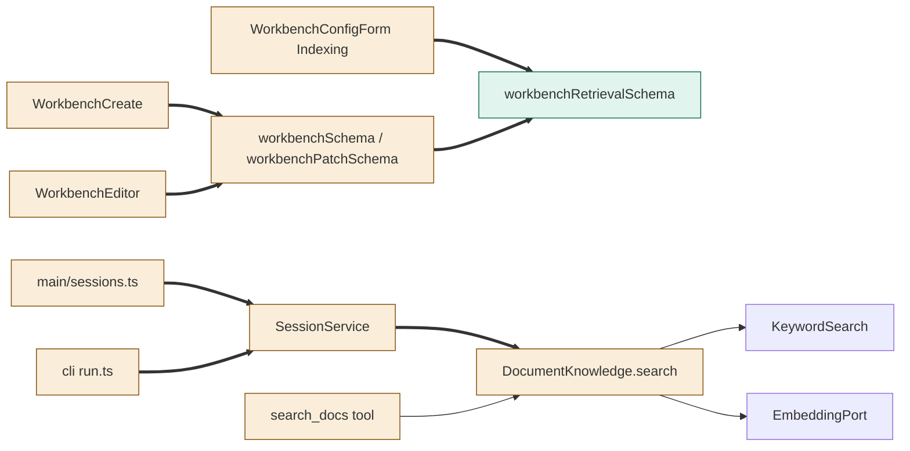
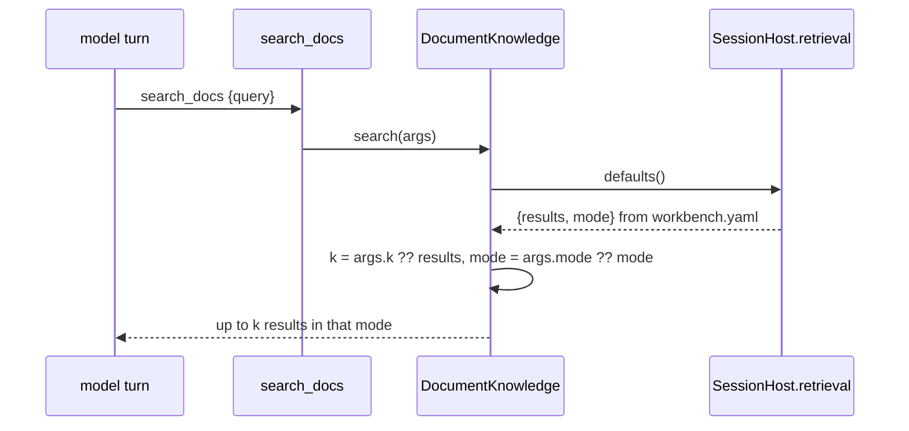

# TASK-3e78d66b diagrams

Illustrates `## Design` in `TASK-3e78d66b.md`. The Design text is authoritative.

Node classes (from the Design):

| Node | Class |
|---|---|
| workbenchRetrievalSchema | added |
| workbenchSchema / workbenchPatchSchema / mergeWorkbench / configWarnings | changed |
| searchDocsSchema, DocumentKnowledge.search, search_docs tool | changed |
| SessionService (SessionHost.retrieval) | changed |
| desktop main/sessions.ts, cli run.ts | changed |
| WorkbenchConfigForm Indexing section, WorkbenchCreate, WorkbenchEditor | changed |
| KeywordSearch, EmbeddingPort | unchanged |

## Structure

## Sequence

## State

Not drawn: the Design adds configuration values, not a lifecycle or status field.
