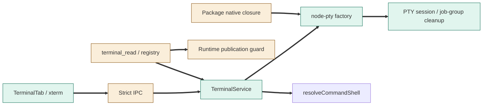
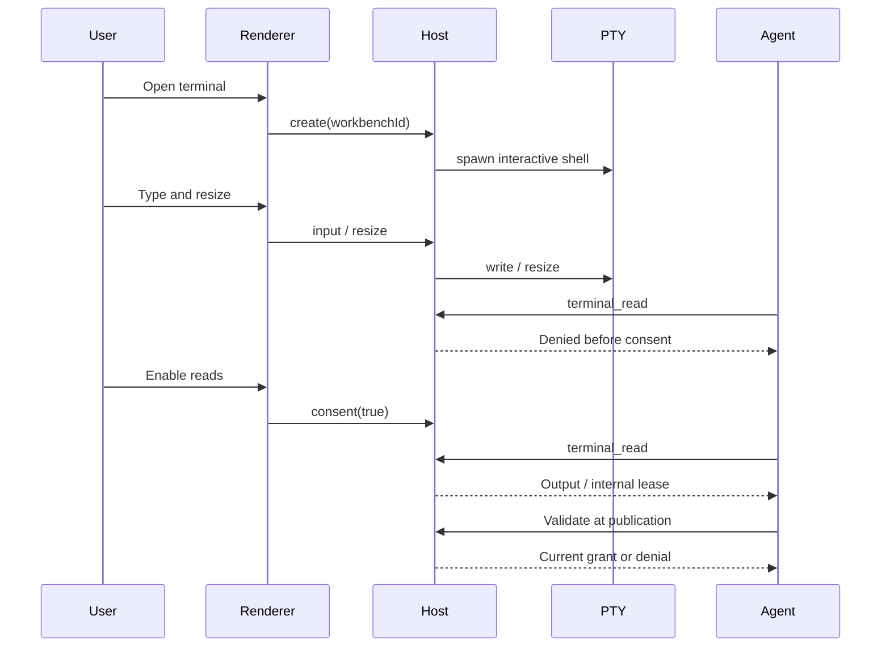
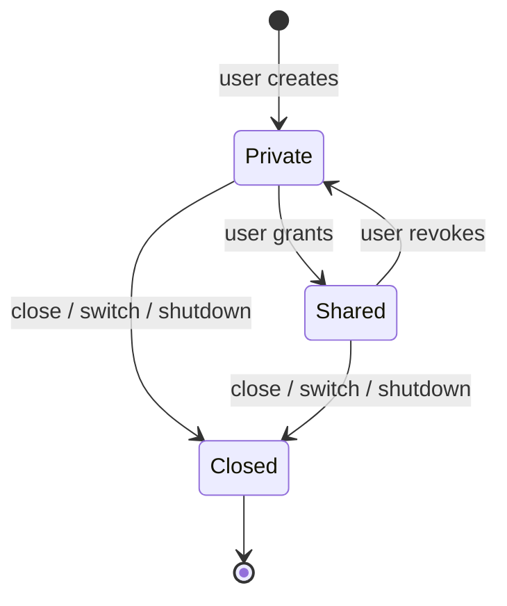

# TASK-3f5447b9 diagrams

Illustrates the authoritative Design in TASK-3f5447b9.md.

## Structure

Node map: TerminalTab, TerminalService and PTY factory added; IPC, registry/runtime and package closure changed; shell resolver reused unchanged.

## Sequence

## State

