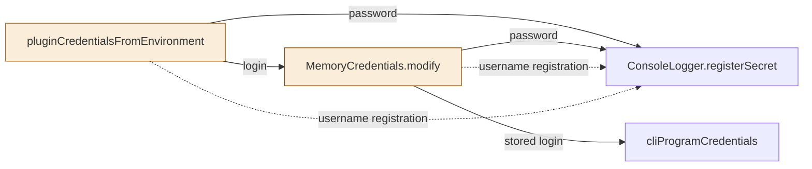
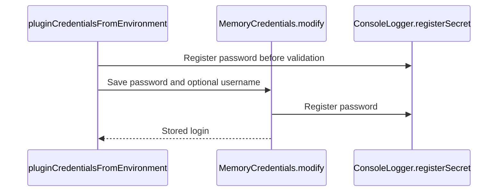

# TASK-40109a62 diagrams

Illustrates the Design in `TASK-40109a62.md`.

## Structure

Changed: `pluginCredentialsFromEnvironment`, `MemoryCredentials.modify`. Reused: `ConsoleLogger.registerSecret`, `cliProgramCredentials`.

## Sequence

## State

Not drawn: credential lifetime and state transitions are unchanged.
