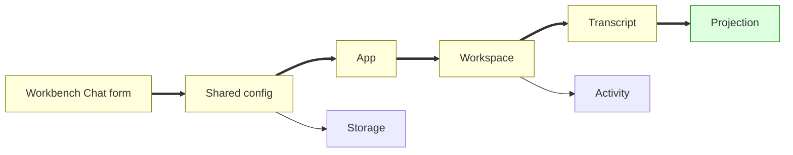
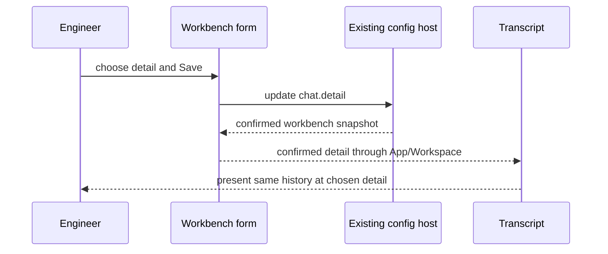

# Chat detail design

Node map: Config/Form/App/Workspace/Transcript changed; Projection added; Storage/Activity reused unchanged.

## Structure

## Sequence

## State
Not drawn: no execution lifecycle or new state transitions; existing settings draft/save behavior is reused.
