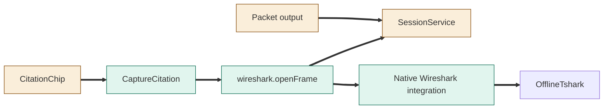
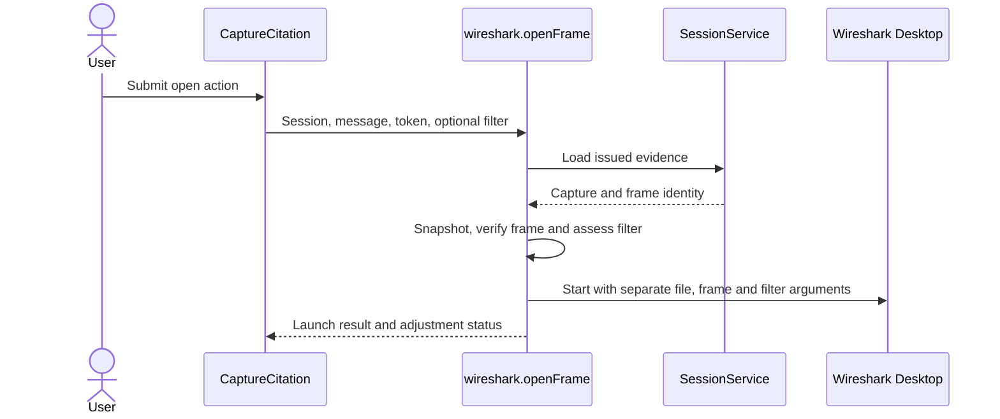
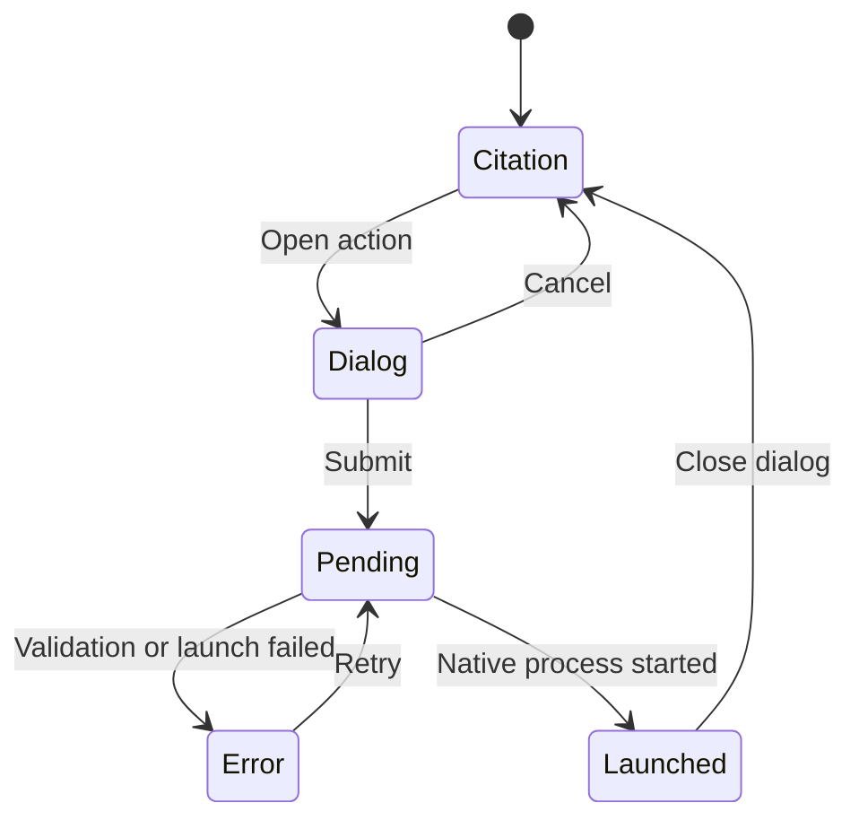

# TASK-41c72419 diagrams

The [design](TASK-41c72419.md) defines the contract.

## Structure

`CitationChip`, `SessionService` and packet output change. `CaptureCitation`, the IPC handler and
native Wireshark integration are added. `OfflineTshark` is reused.

## Sequence

## State

