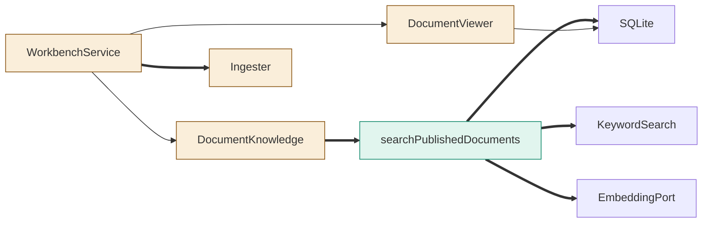
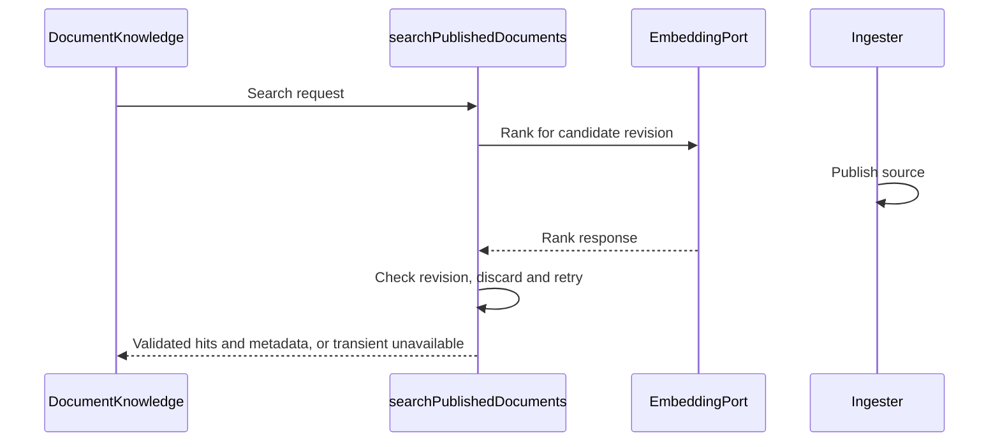
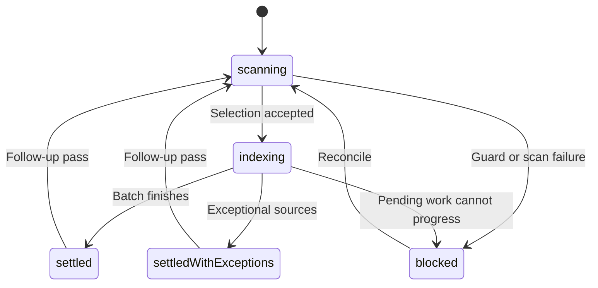

# TASK-4226b5fe diagrams

Illustrates the journal design in [TASK-4226b5fe.md](TASK-4226b5fe.md).

## Structure

- Added: searchPublishedDocuments.
- Changed: DocumentKnowledge, WorkbenchService, Ingester, DocumentViewer.
- Reused: KeywordSearch, EmbeddingPort, SQLite.

## Sequence

## State

