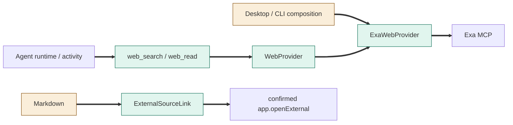
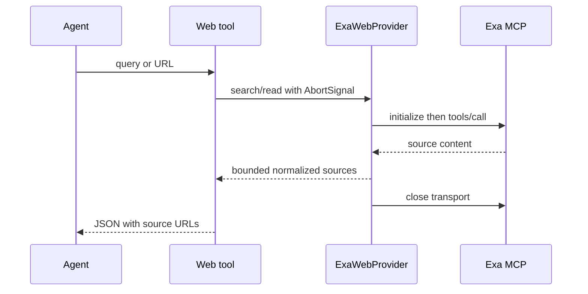
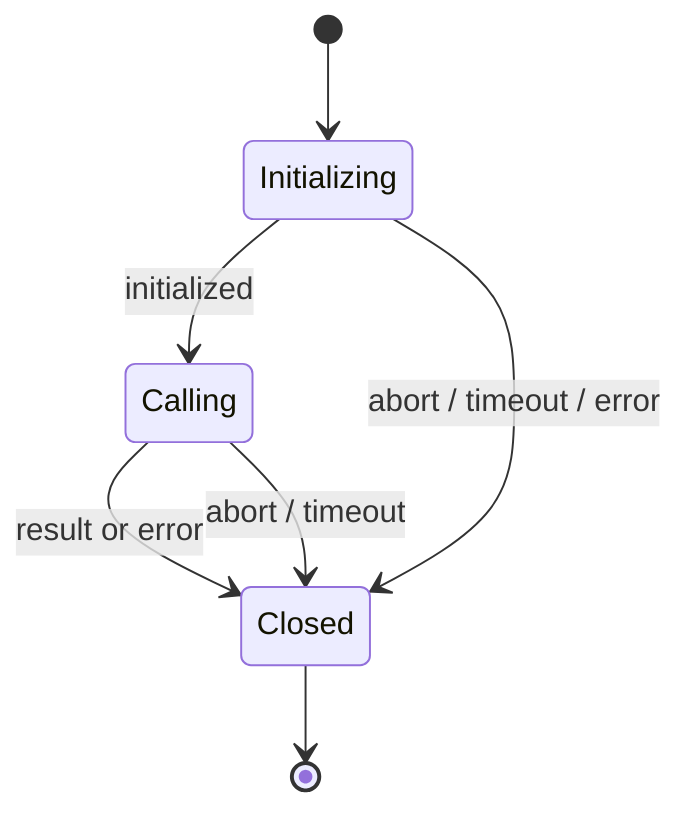

# TASK-4262ecbb diagrams

Illustrates Design in TASK-4262ecbb.md; Design is authoritative.

## Structure

Map: WebProvider, ExaWebProvider, web tools and ExternalSourceLink added; composition, catalog, prompt and Markdown changed; runtime/activity reused.

## Sequence

## State

