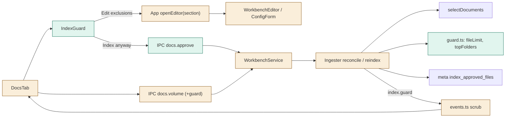
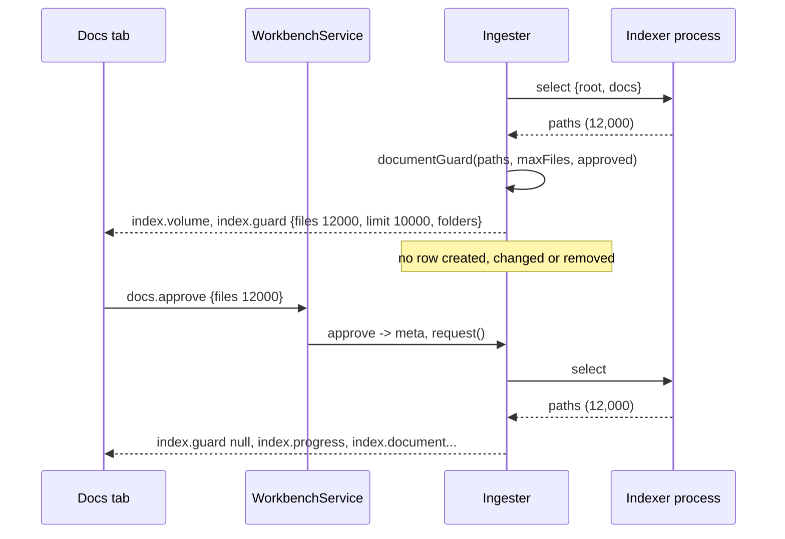
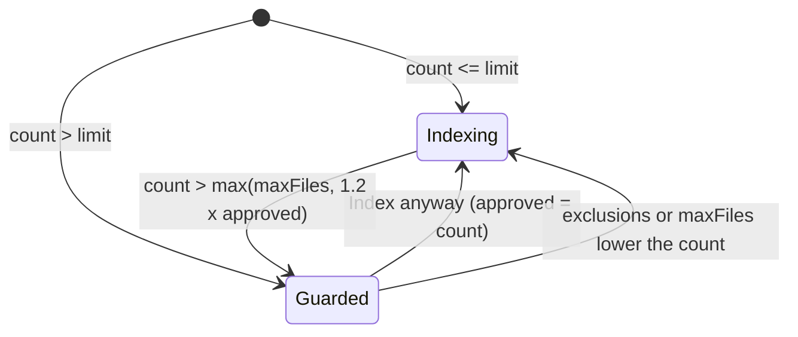

# TASK-4321c06b diagrams

Illustrates `## Design` in `TASK-4321c06b.md`. The Design text is authoritative.

Node map: added = guard.ts, IndexGuard, docs.approve, index.guard; changed = Ingester reconcile/reindex,
WorkbenchService, docs.volume, DocsTab, App openEditor, WorkbenchEditor/ConfigForm, events.ts scrub;
unchanged = selectDocuments, meta table.

## Structure

## Sequence

## State

