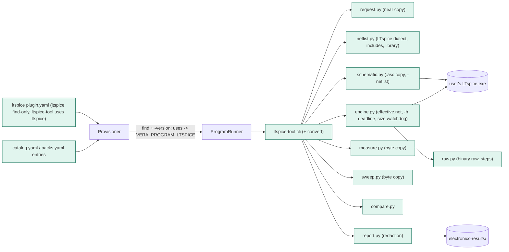
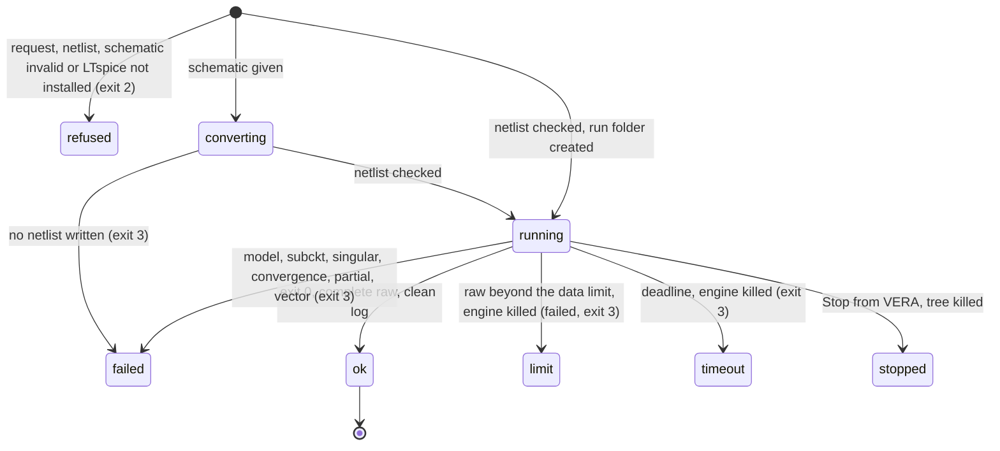

# TASK-43e9ee14 diagrams

Illustrates `## Design` in `TASK-43e9ee14.md`. The Design text is authoritative.

Node classes: added - ltspice plugin manifest, ltspice-tool (cli, request, netlist, schematic, engine, raw, measure,
sweep, compare, report), catalog/packs entries; changed - none; unchanged - Provisioner (find, `uses`),
ProgramRunner, the user's LTspice.

## Structure



## Sequence

```mermaid
sequenceDiagram
    participant Agent
    participant Runner as ProgramRunner
    participant Tool as ltspice-tool
    participant LT as LTspice.exe
    Agent->>Runner: run_program ltspice-tool run --input req.json
    Runner->>Tool: start (env VERA_PROGRAM_LTSPICE)
    Tool->>Tool: read request; .asc? copy schematic folder
    Tool->>LT: -netlist input/x.asc (only for schematics)
    LT-->>Tool: input/x.net
    Tool->>Tool: check netlist chain, refuse before the engine
    Tool->>Tool: copy includes, effective.net (.temp, .save, analysis, .step)
    Tool->>LT: -b effective.net (cwd run folder, deadline, size watchdog)
    LT-->>Tool: exit, effective.log, effective.raw
    Tool->>Tool: classify log, parse raw (steps), measure, criteria
    Tool-->>Runner: summary (result.json, report.md, series.csv, plot.svg)
    Runner-->>Agent: output; Stop kills the tree
```

## State


