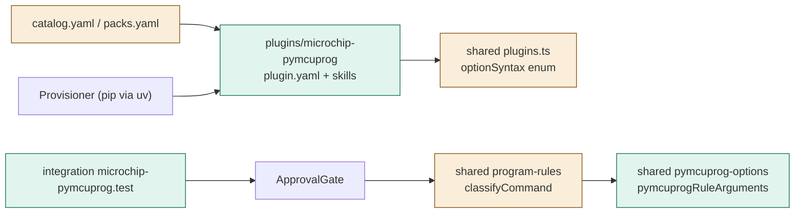

# TASK-46fcedc2 diagrams

Illustrates `## Design` in `TASK-46fcedc2.md`. The Design text is authoritative.

Node map: added = microchip-pymcuprog package, pymcuprog-options projection, fixture, test; changed = plugins.ts enum,
classifyCommand dispatch, catalog/packs; unchanged = Provisioner, ApprovalGate, ProgramRunner.

## Structure

## Sequence

Not drawn: the flow is the existing run_program path (classify, gate, runner) shown for PLG-15 and PLG-14.

## State

Not drawn: no new lifecycle.
