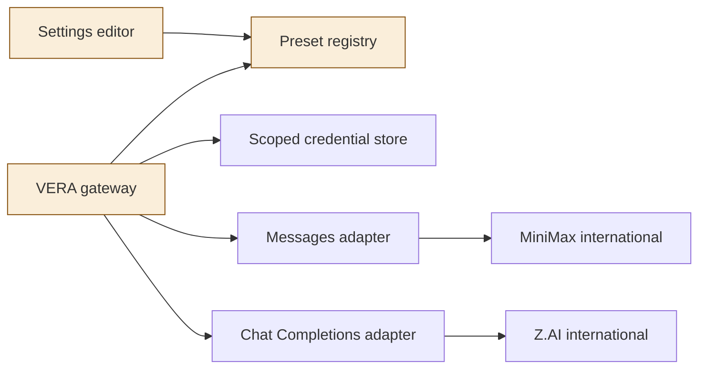
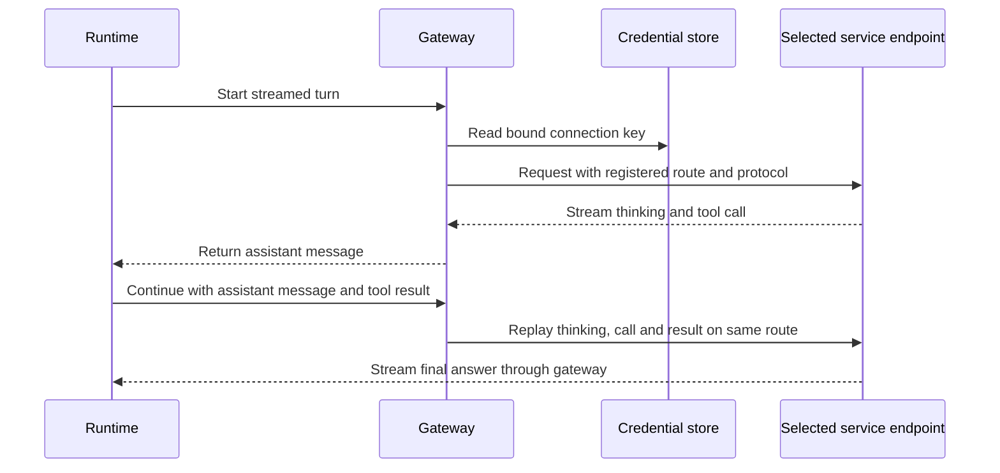

# TASK-48e18516 diagrams

Illustrates the design in [TASK-48e18516.md](TASK-48e18516.md).

## Structure

Changed nodes are the preset registry, Settings editor and gateway. The
credential store, pinned adapters and external services retain their interfaces.

## Sequence

## State

No lifecycle or persisted state transition changes.
