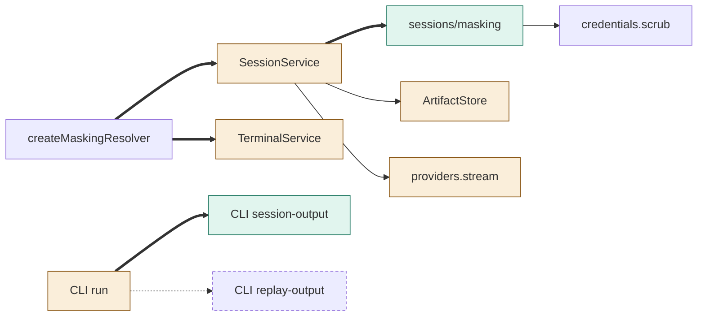
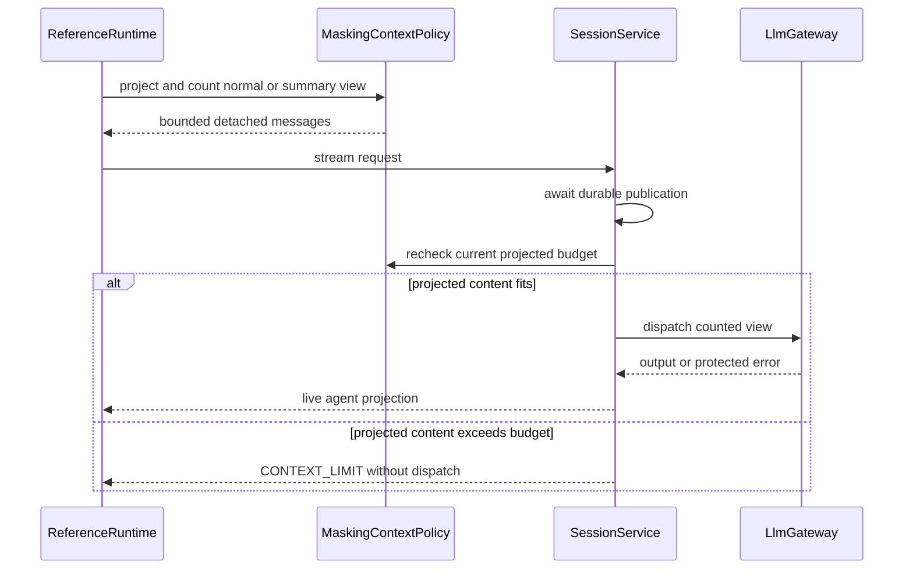

# TASK-4912fc24 diagrams

Illustrates `## Design` in `TASK-4912fc24.md`. The Design text is authoritative.

## Structure

Node map: SessionService, providers, ArtifactStore, TerminalService and CLI run are changed;
sessions/masking and CLI session-output are added; CLI replay-output is removed;
createMaskingResolver and credentials.scrub are reused unchanged.

## Sequence

## State

Not drawn: this task consumes the existing masking choices and preserves existing execution,
consent, session and storage state transitions.
