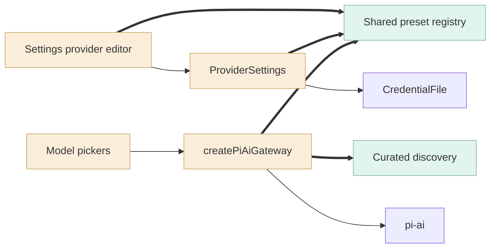
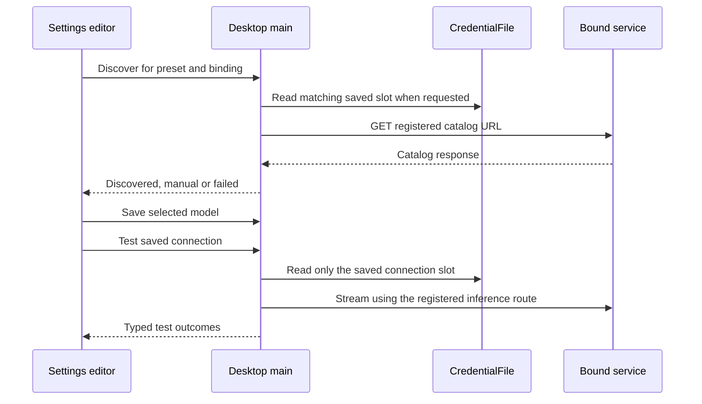
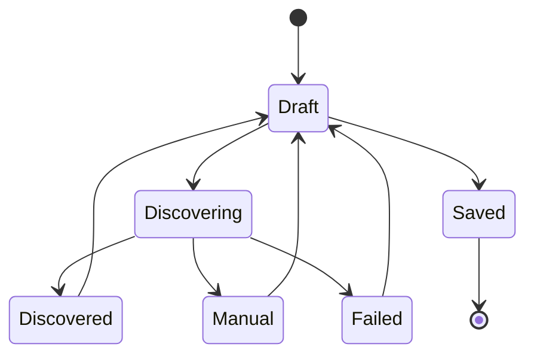

# TASK-49fbfd2e diagrams

Illustrates the task journal's Design.

## Structure

Added: shared registry and curated catalog. Changed: Settings UI, ProviderSettings, gateway and model pickers. Reused: CredentialFile and pi-ai.

## Sequence

## State

