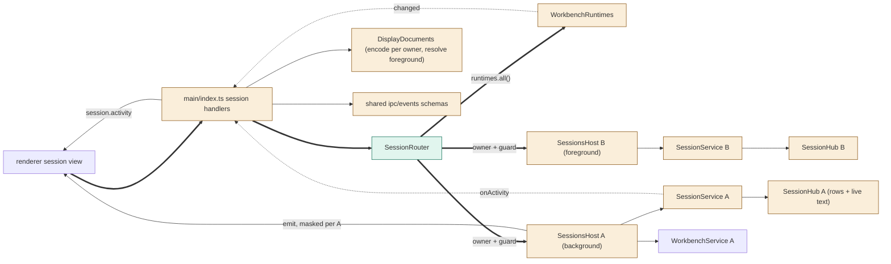
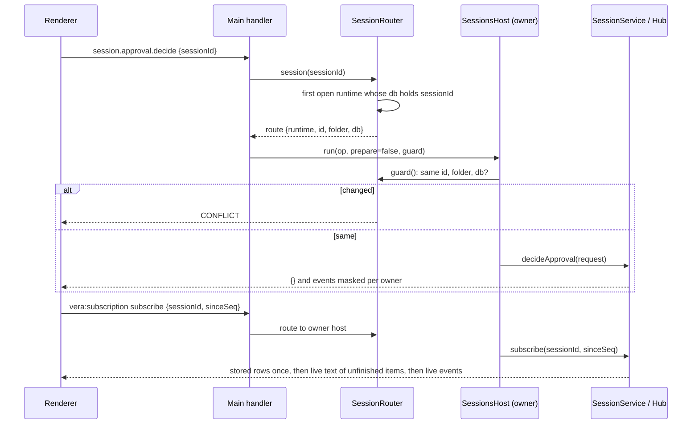

# TASK-4a82060d diagrams

Illustrates `## Design` in `TASK-4a82060d.md`. The Design text is authoritative.

Node classes: SessionRouter = added; index.ts handlers, SessionsHost, WorkbenchRuntimes, SessionHub,
SessionService, DisplayDocuments, shared IPC/events = changed; WorkbenchService, renderer session view =
unchanged.

## Structure

## Sequence

## State

```mermaid
stateDiagram-v2
    [*] --> Empty
    Empty --> Streaming: message.delta / reasoning.delta / tool.update kept per item
    Streaming --> Streaming: more deltas (tail 500000 chars)
    Streaming --> Streaming: message.done drops that message text; tool.done drops that tool output
    Streaming --> Empty: turn.done or session.interrupted
    Empty --> [*]: hub cleared on close
```

