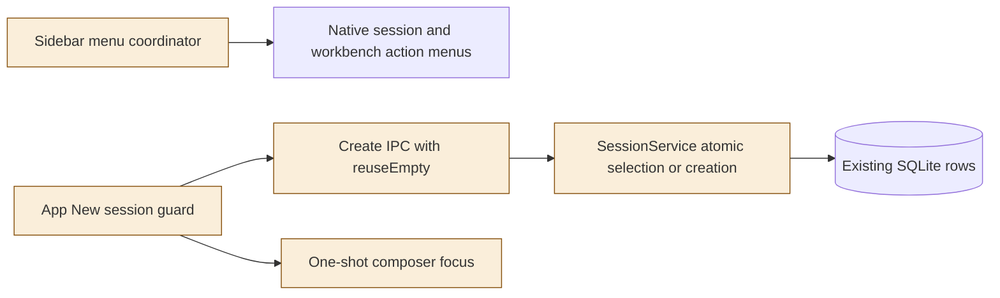
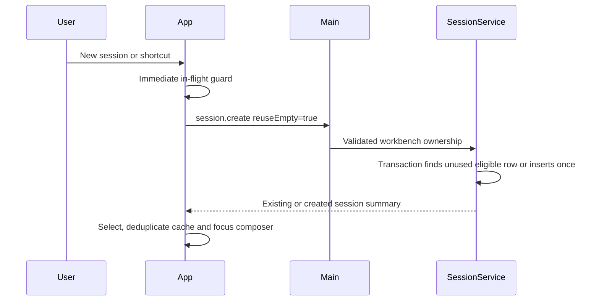
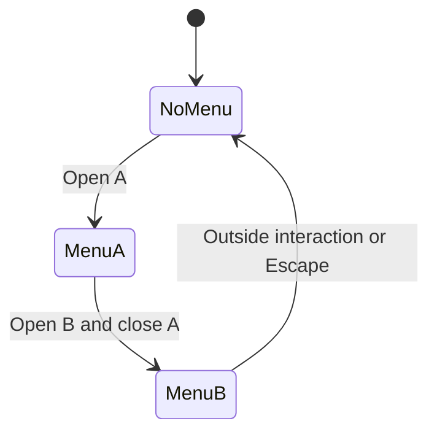

# TASK-4b3878c7 diagrams

Illustrates Design in TASK-4b3878c7.md.

## Structure
Changed: sidebar coordinator, App/create IPC, SessionService reuse, composer focus. SQLite store reused.

## Sequence

## State

