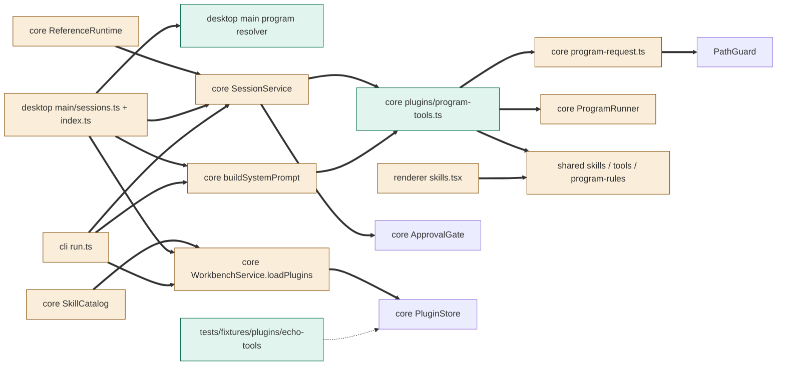
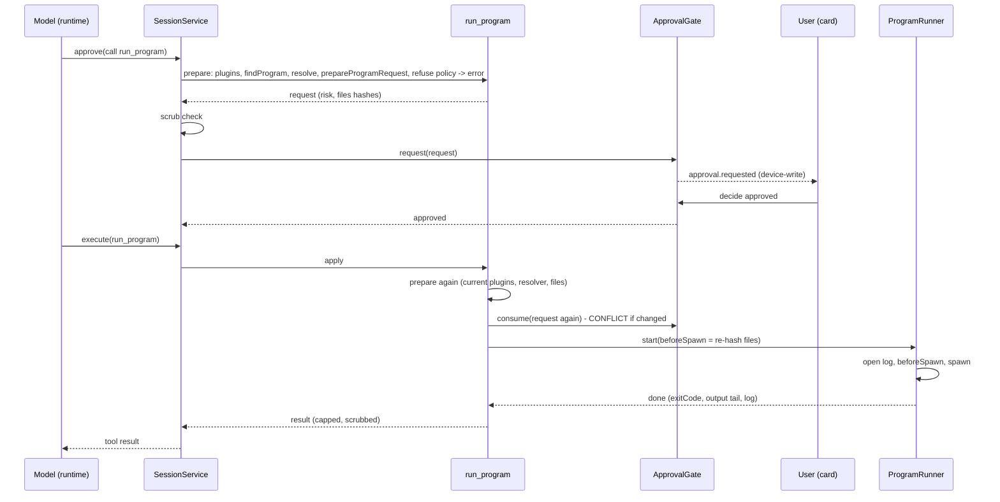
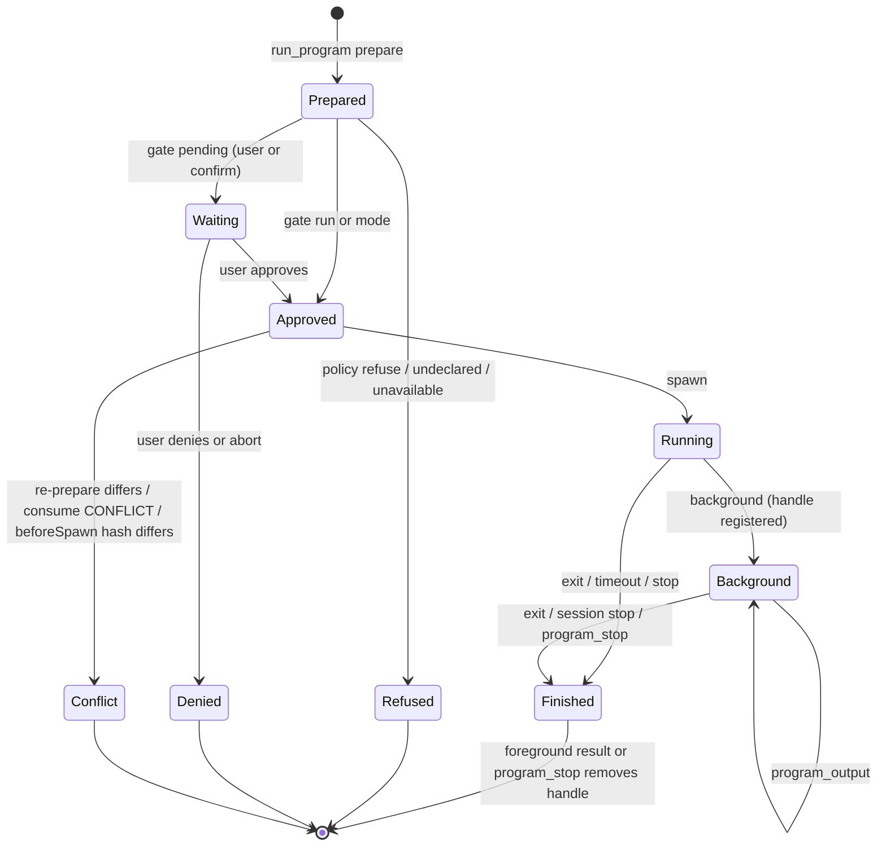

# TASK-4f040d30 diagrams

Illustrates `## Design` in `TASK-4f040d30.md`. The Design text is authoritative.

Node classes: added = program-tools.ts, desktop program resolver, echo-tools fixture plugin; changed =
SessionService, ReferenceRuntime, program-request.ts, ProgramRunner, buildSystemPrompt, SkillCatalog,
WorkbenchService, shared skills/tools/program-rules, desktop sessions host and main, CLI run.ts,
renderer skills settings; unchanged = ApprovalGate, PluginStore, PathGuard.

## Structure

## Sequence

## State

