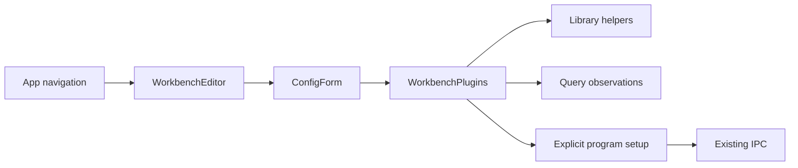

# TASK-4f522ea5 diagrams

Illustrates Design in TASK-4f522ea5.md. Map: Editor/Form/Selection changed; Library helpers/cache/API reused; WB setup disclosure added within Selection.

## Structure

## Sequence
```mermaid
sequenceDiagram
  participant U as Engineer
  participant E as Editor draft
  participant P as Plugin selection
  participant A as Existing IPC
  U->>P: filter / toggle
  P->>E: update full enabled list
  U->>A: global Plugins install detour
  Note over E: same owner hidden/inert, draft retained
  U->>E: return to same workbench
  E->>P: restore section/filter; refresh package list
  U->>E: Save
  E->>A: workbench.config.update
  A-->>E: saved snapshot
```
## State

```mermaid
stateDiagram-v2
  Clean --> Dirty: selection changes
  Dirty --> Clean: restored enabled set
  Dirty --> Saving: Save
  Dirty --> HiddenDirty: global Plugins detour
  HiddenDirty --> Dirty: return to same workbench
  HiddenDirty --> Closed: confirmed actual departure
  Saving --> Dirty: failure retains draft
  Saving --> Closed: saved
  Dirty --> Closed: Cancel
```

