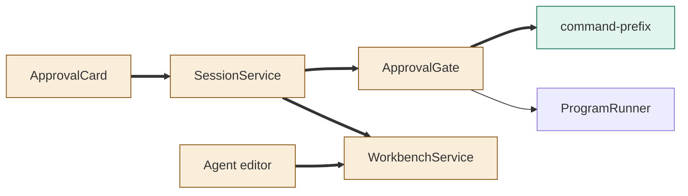
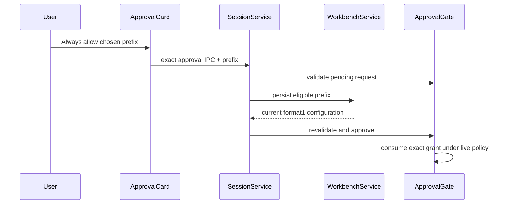

# TASK-4fbe3463 diagrams

Design is authoritative. Map: command-prefix added; ApprovalGate, SessionService, WorkbenchService, ApprovalCard and Agent editor changed; runner reused unchanged.

## Structure

## Sequence

## State

Not drawn: existing approval lifecycle remains unchanged.
