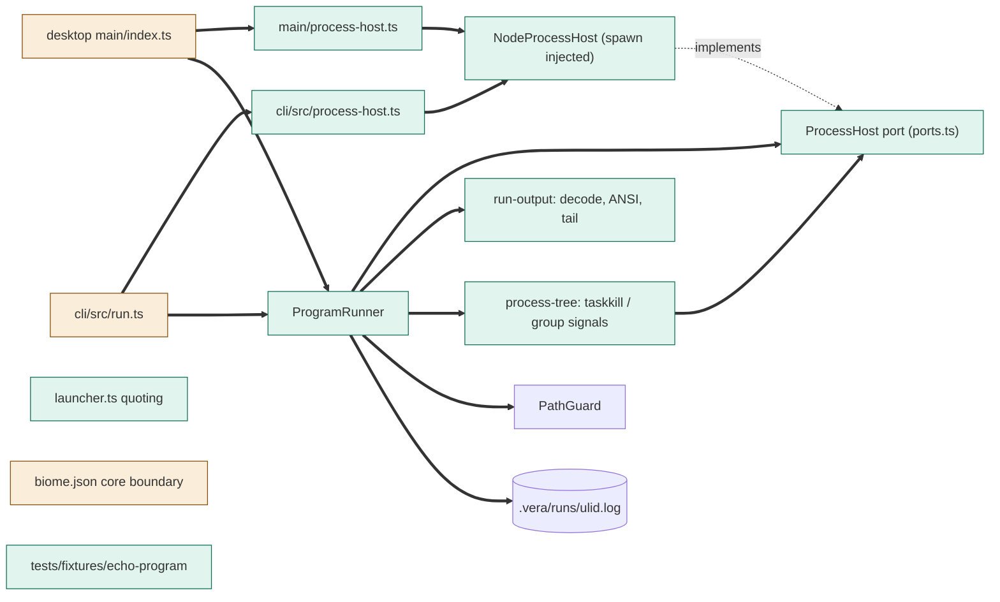
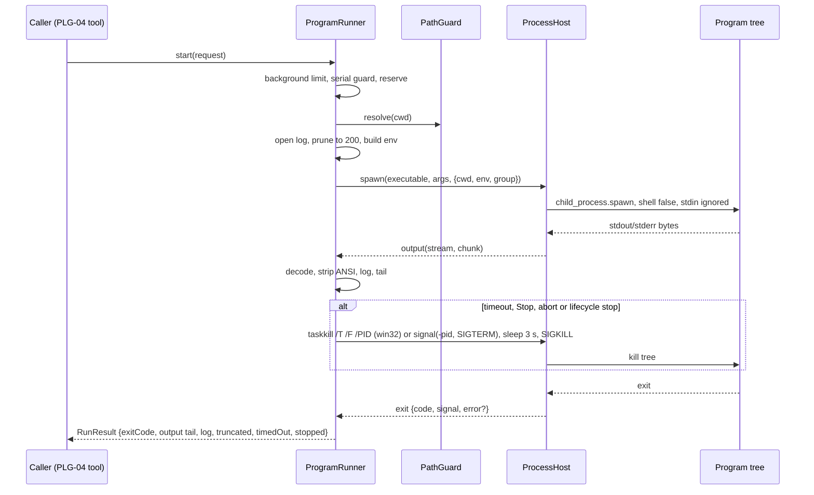
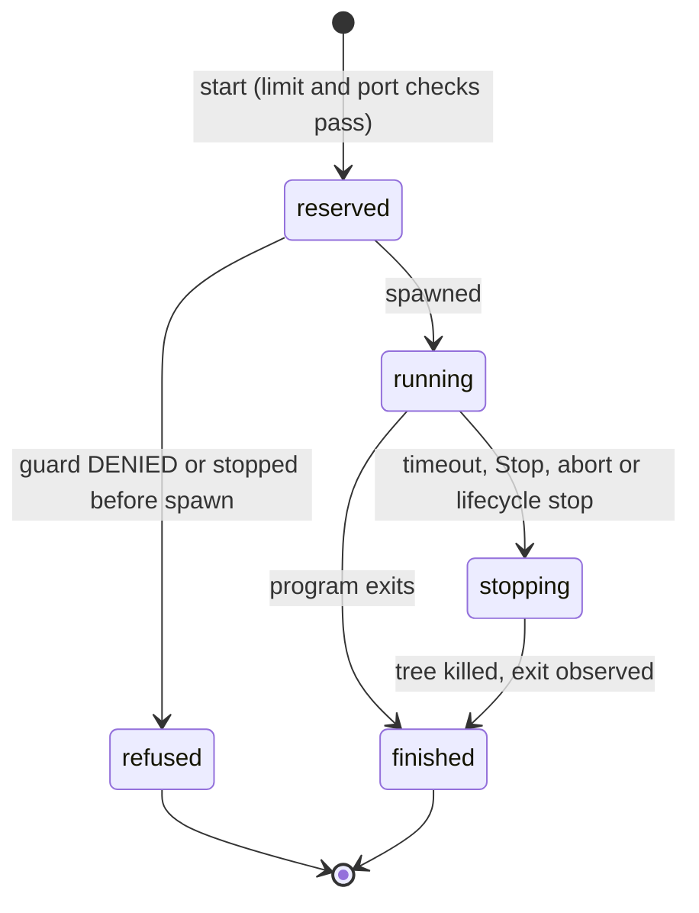

# TASK-50789c10 diagrams

Illustrates `## Design` in `TASK-50789c10.md`. The Design text is authoritative.

Node classes: added = ProcessHost port, NodeProcessHost, ProgramRunner, run-output, launcher,
process-tree, desktop process-host, CLI process-host, echo-program fixture; changed = desktop main
index, CLI run, biome boundary; unchanged = PathGuard.

## Structure

## Sequence

## State

