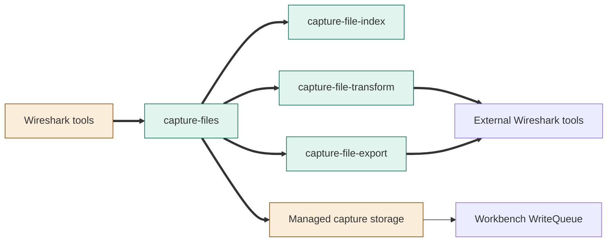
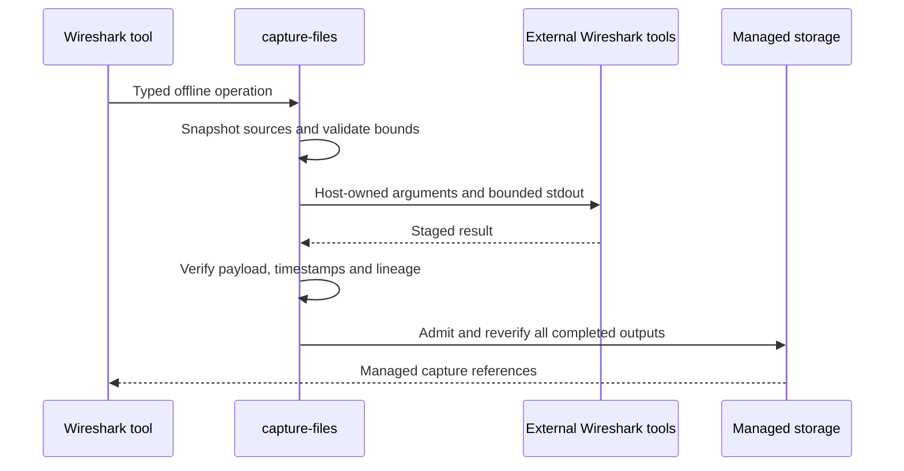
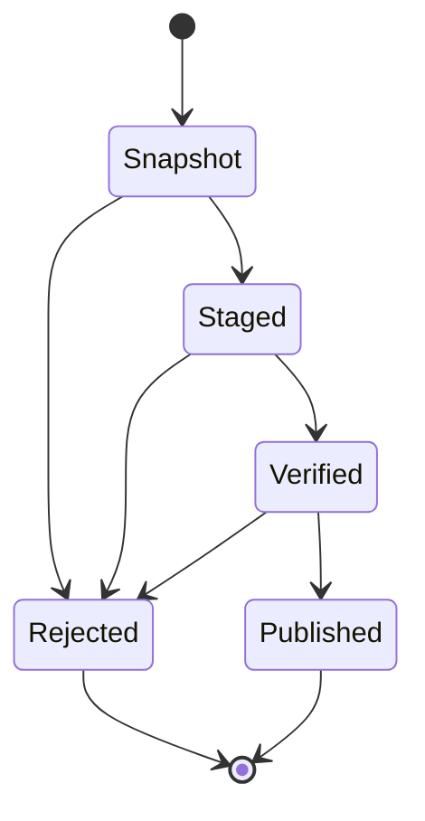

# TASK-51a634d5 diagrams

The design in [TASK-51a634d5](TASK-51a634d5.md) defines the implementation.

## Structure

Node map: added = capture-files, packet index, transforms, exports; changed = tools and managed storage; reused = write queue and external Wireshark tools.

## Sequence

## State

