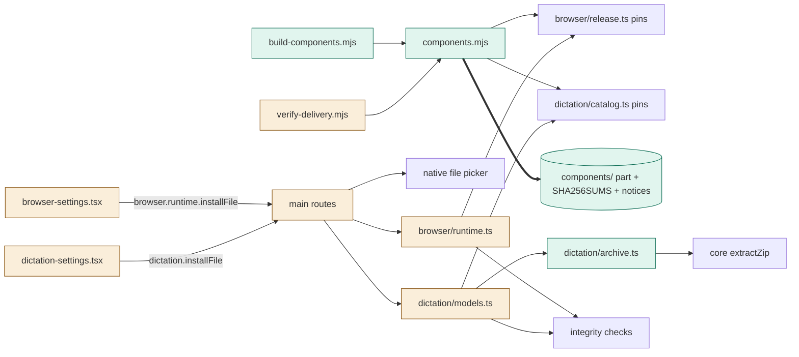
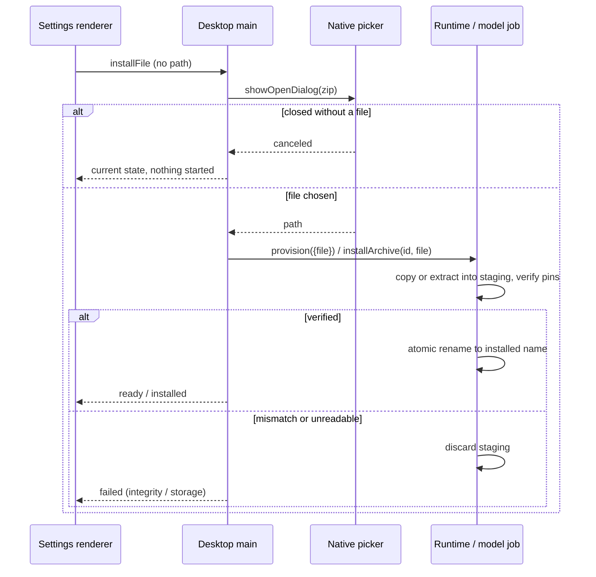
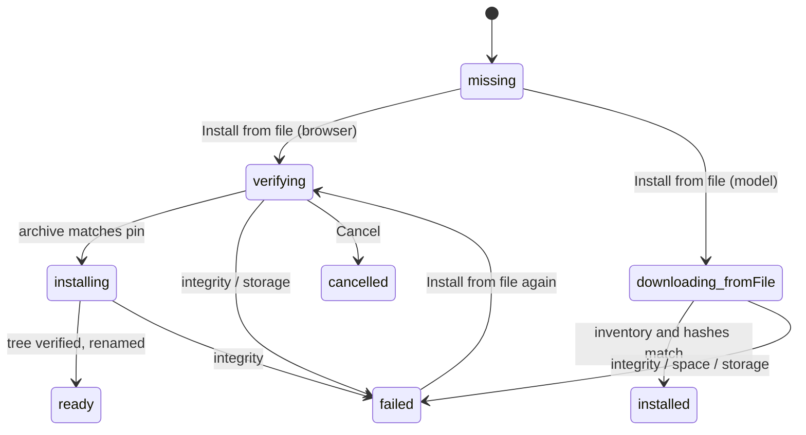

# TASK-52e81374 diagrams

Illustrates `## Design` in `TASK-52e81374.md`. The Design text is authoritative.

Node classes: added = `components.mjs`, `build-components.mjs`, `dictation/archive.ts`, `components/ part`; changed = `verify-delivery.mjs`, `runtime.ts`, `models.ts`, `main routes`, `browser-settings.tsx`, `dictation-settings.tsx`; unchanged = `release.ts`, `catalog.ts`, `integrity checks`, `extractZip`, native picker.

## Structure

## Sequence

## State

