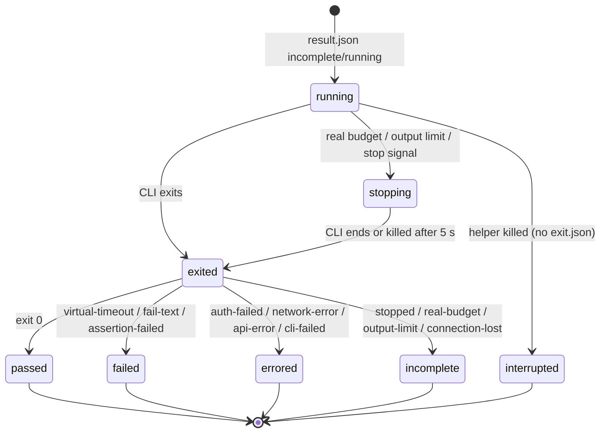

# TASK-55160e0d diagrams

Illustrates `## Design` in `TASK-55160e0d.md`. The Design text is authoritative.

Node classes: added = plugin wokwi, wokwi_support modules, wokwi.credentials channels, fake wokwi-cli; changed =
plugin-credentials (shared schema, desktop service, Settings panel, CLI env reader; renamed from mqtt-*),
program-tools (per-scope message); unchanged = ProgramRunner, approval gate, CredentialStore, wokwi-cli.

## Structure

```mermaid
flowchart LR
    classDef added fill:#e1f5ee,stroke:#0f6e56
    classDef changed fill:#faeeda,stroke:#854f0b
    settings["Settings panel (mqtt | wokwi)"]:::changed --> ipc["wokwi.credentials.* IPC"]:::added
    ipc --> service["PluginCredentialService(scope)"]:::changed
    cliEnv["CLI VERA_WOKWI_TOKEN_REF"]:::changed --> store[("CredentialStore wokwi:ref")]
    service --> store
    store --> tools["program-tools credentialInput"]:::changed
    tools --> runner["ProgramRunner stdin line"]
    runner --> helper["wokwi_support.cli"]:::added
    helper --> offline["project / diagram / scenario / job / collect / report"]:::added
    helper --> run["run.py watch loop"]:::added
    offline --> engine["engine.py (lint --offline, version)"]:::added
    run --> engine
    engine --> wcli[("wokwi-cli 0.29.1")]
    wcli --> cloud[("wss://wokwi.com/api/ws/beta")]
    offline --> results[("arduino-iot-results/&lt;run-id&gt;")]
    run --> results
```



## Sequence

```mermaid
sequenceDiagram
    participant A as Agent
    participant V as VERA program tools
    participant H as wokwi-tool
    participant C as wokwi-cli
    participant W as Wokwi cloud
    A->>V: run_program wokwi-tool prepare-job (safe)
    V->>H: prepare-job
    H-->>V: job.json + send list, account, limits
    A->>V: run_program run-scenario --job job.json --credential ref
    V->>V: irreversible: typed confirmation, job.json hash bound
    V->>H: start, stdin = {scope wokwi, ref, token}
    H->>H: verify every job file hash
    H->>C: send/ --no-sdcard ... (WOKWI_CLI_TOKEN in env only)
    C->>W: upload diagram, firmware, ELF; run
    W-->>C: serial, pins, end
    C-->>H: exit code, stderr
    H-->>V: result.json outcome, remote state, virtual/real time
```

## State


