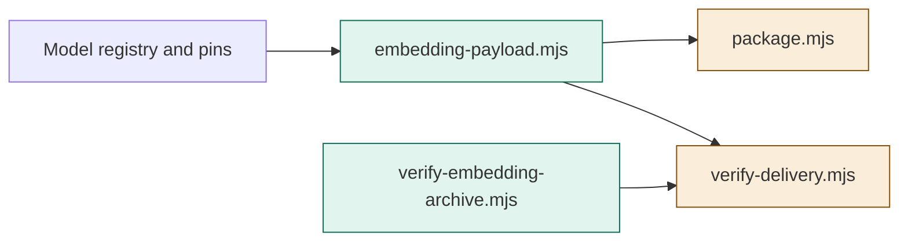
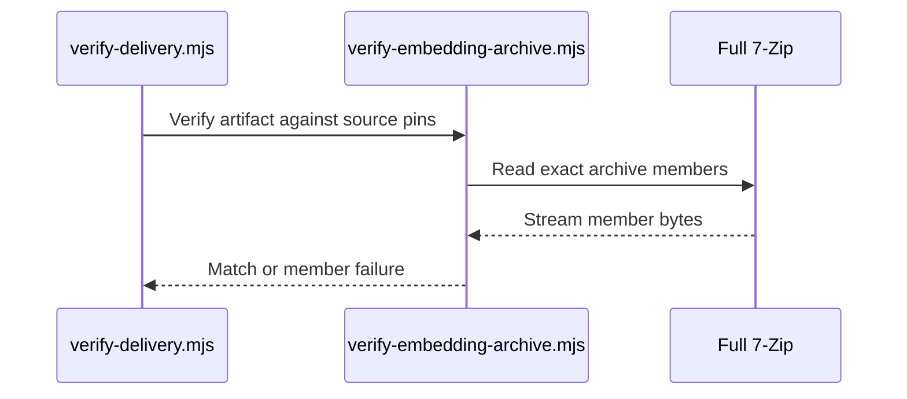

# TASK-55f2119e diagrams

Illustrates the Design in [TASK-55f2119e.md](TASK-55f2119e.md).

## Structure

The package and delivery commands change. The shared pin catalog and archive reader are added. The model registry and files remain inputs.

## Sequence

## State

No lifecycle or status fields change.
