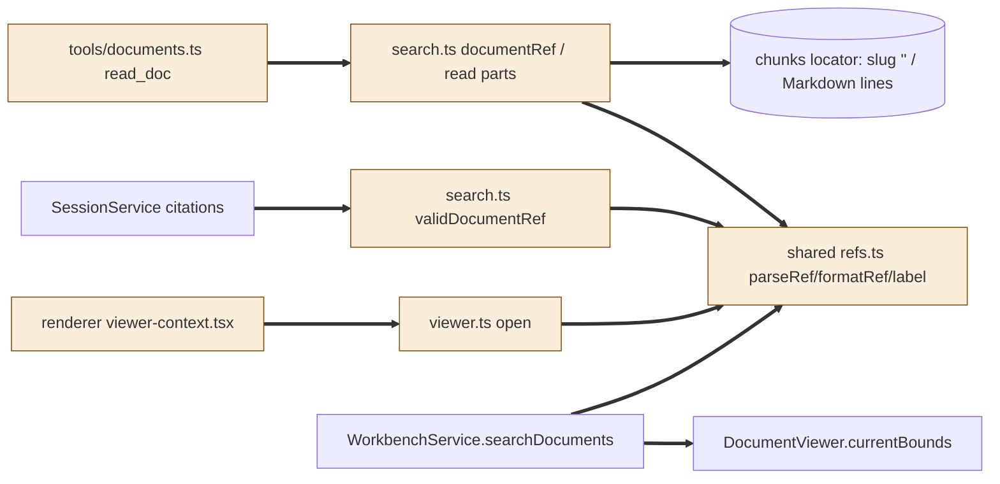
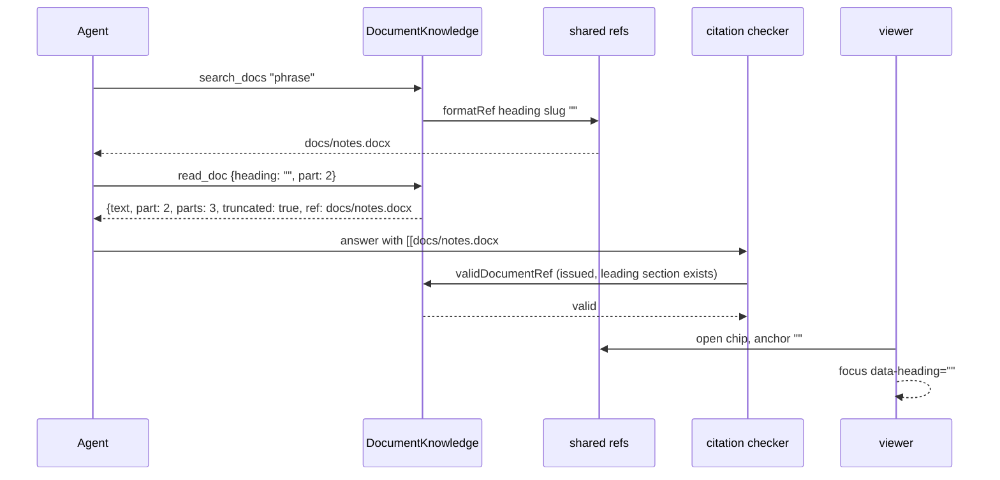

# TASK-58318df2 diagrams

Illustrates `## Design` in `TASK-58318df2.md`. The Design text is authoritative.

Node classes (from the Design):

| Node | Class |
|---|---|
| shared refs.ts (grammar, label) | changed |
| search.ts documentRef, read (parts), validDocumentRef | changed |
| viewer.ts open anchor | changed |
| renderer viewer-context.tsx anchor effect | changed |
| tools/documents.ts read_doc description | changed |
| WorkbenchService.searchDocuments, currentBounds, chunk locators, SessionService citations | unchanged (reused) |

## Structure

## Sequence

## State

Not drawn: no lifecycle or status changes; part reads are stateless requests.
