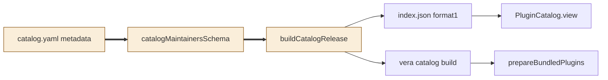
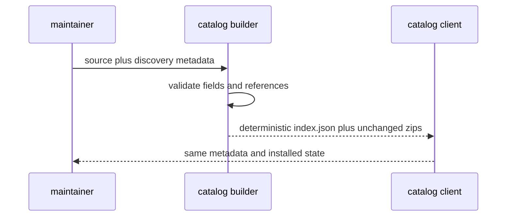

# TASK-5995883b diagrams
Illustrates Design in TASK-5995883b.md. The Design text is authoritative.

## Structure
Node map: shared discovery schema and catalog source builder changed; client, CLI, bundle preparation reused unchanged.

## Sequence

## State
Not drawn: no lifecycle or state transition is changed.
