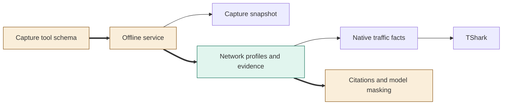
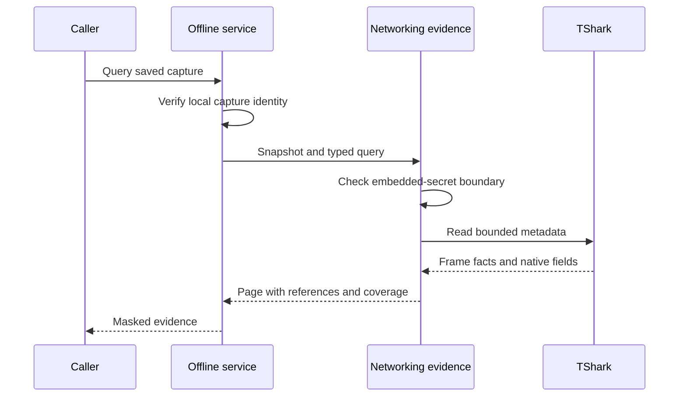

# TASK-59b52191 diagrams

See [the task design](TASK-59b52191.md).

## Structure

Changed: tool schema, offline service, citations and masking. Added: network profile
and evidence projection. Reused: capture snapshot, traffic facts and native TShark.

## Sequence

## State

No lifecycle or state transitions change.
