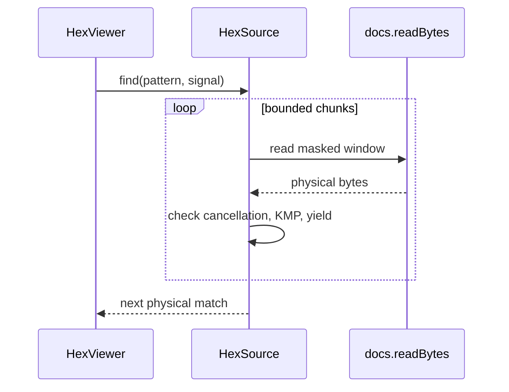
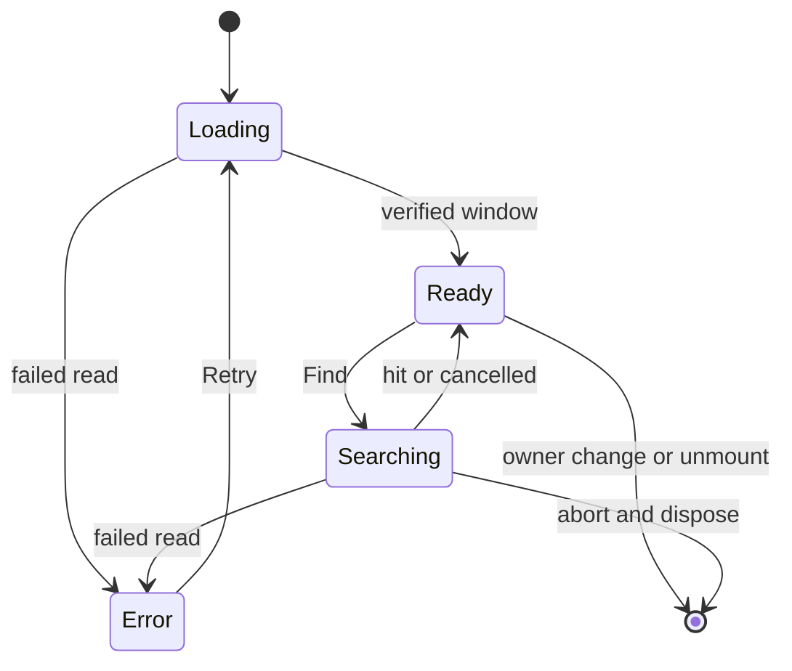

# TASK-5bdc042a diagrams

Illustrates Design in TASK-5bdc042a.md. Design is authoritative.
Node map: viewer-context changed; HexViewer/HexSource added; docs.readBytes unchanged.

## Structure

## Sequence

## State

