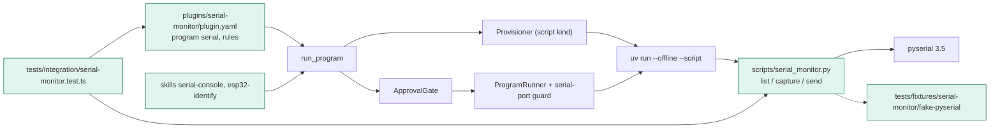
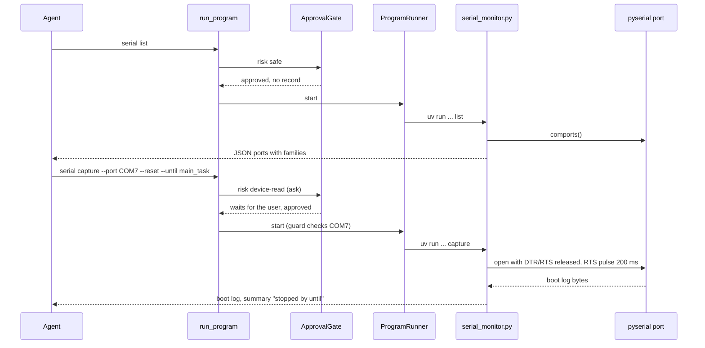

# TASK-5cdbba96 diagrams

Illustrates `## Design` in `TASK-5cdbba96.md`. The Design text is authoritative.

Node map: added = plugin.yaml, serial_monitor.py, skills, fake pyserial, integration test; no class = run_program,
ApprovalGate, ProgramRunner, Provisioner, uv, pyserial (reused unchanged).

## Structure

## Sequence

## State

Not drawn: the script keeps no state between runs and the design adds no lifecycle or status field.
