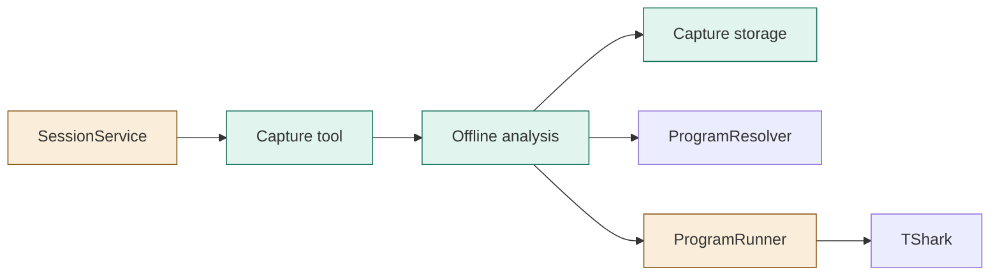
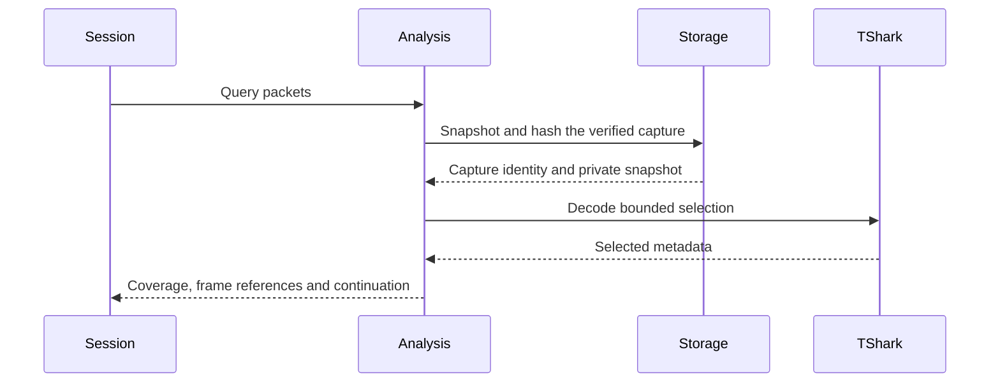
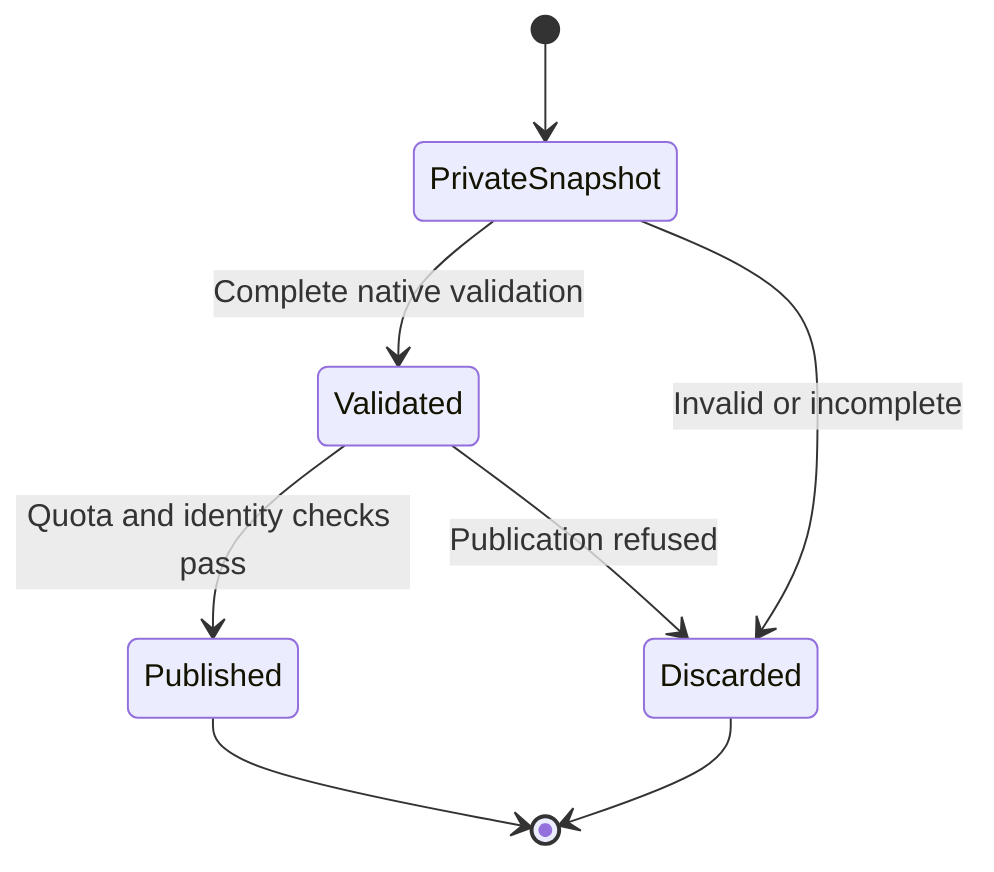

# TASK-5dd935de diagrams

Illustrates the [design](TASK-5dd935de.md).

## Structure

SessionService and ProgramRunner change. The capture tool, analysis service and capture storage
are added. TShark and the resolver are reused.

## Sequence

## State

