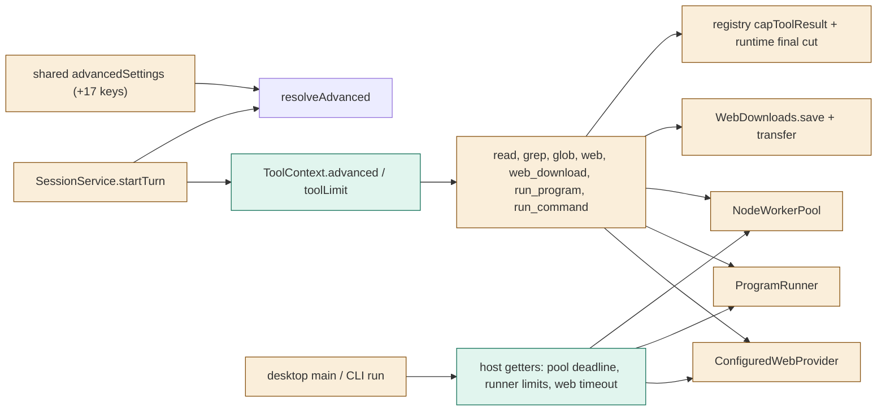
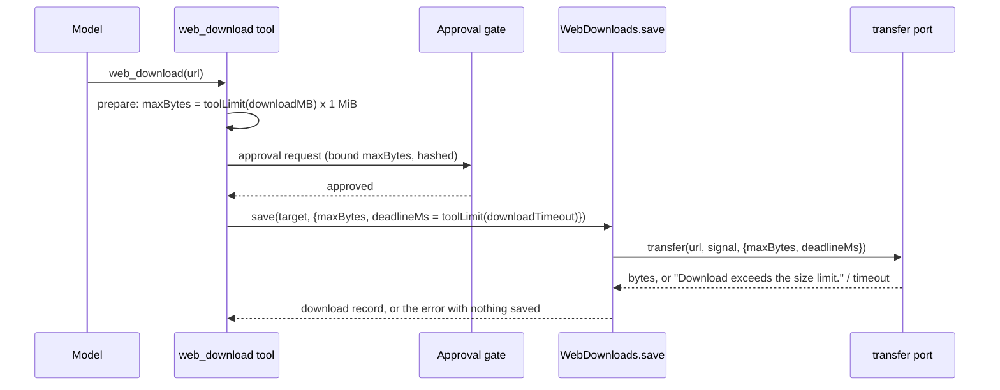

# TASK-5de66ce2 diagrams

Illustrates `## Design` in `TASK-5de66ce2.md`. The Design text is authoritative.

Node classes from the Design: added = `ToolContext.advanced`/`toolLimit`, host getters (pool deadline,
runner limits, web timeout); changed = registry, service, tools (read, grep, glob, web, web_download,
run_program, run_command), runtime final cut, worker pool, runner, configured web provider, WebDownloads,
transfer, desktop/CLI hosts; unchanged = registry `resolveAdvanced`.

## Structure

## Sequence

## State

Not drawn: the design adds no lifecycle, status field or state transition.
