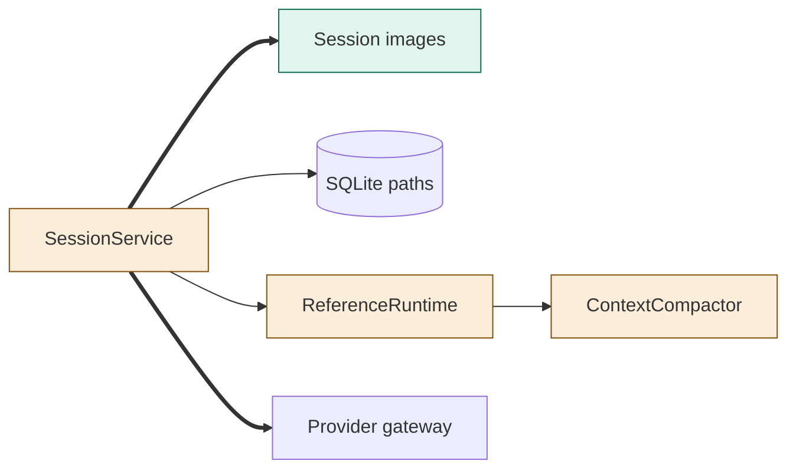
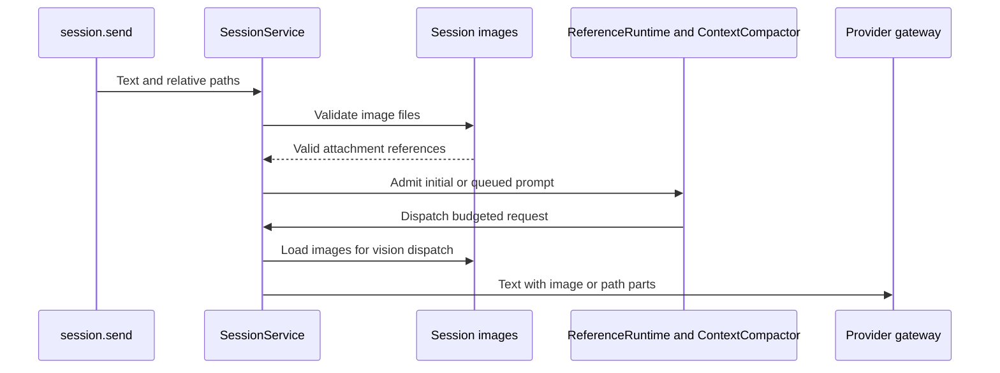

# TASK-5f92b089 diagrams

Illustrates the Design section of [TASK-5f92b089.md](TASK-5f92b089.md).

## Structure

Changed nodes are SessionService, ReferenceRuntime and ContextCompactor. Session images is added. SQLite and the provider gateway are reused.

## Sequence

## State

Not drawn because chat admission and turn states are reused.
