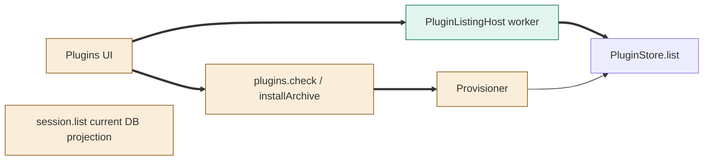
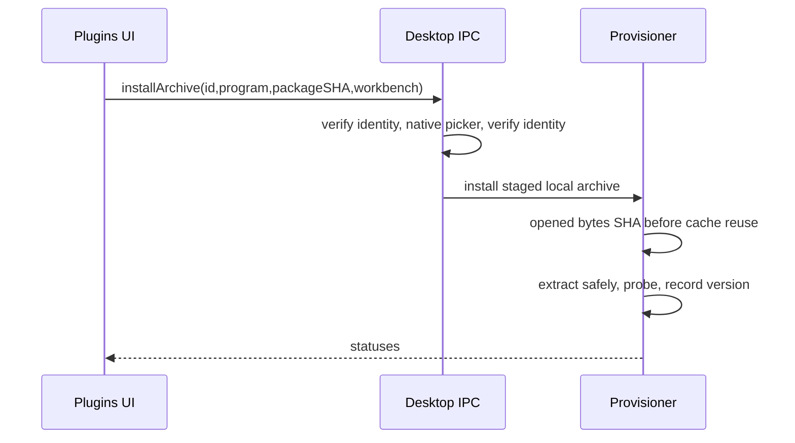
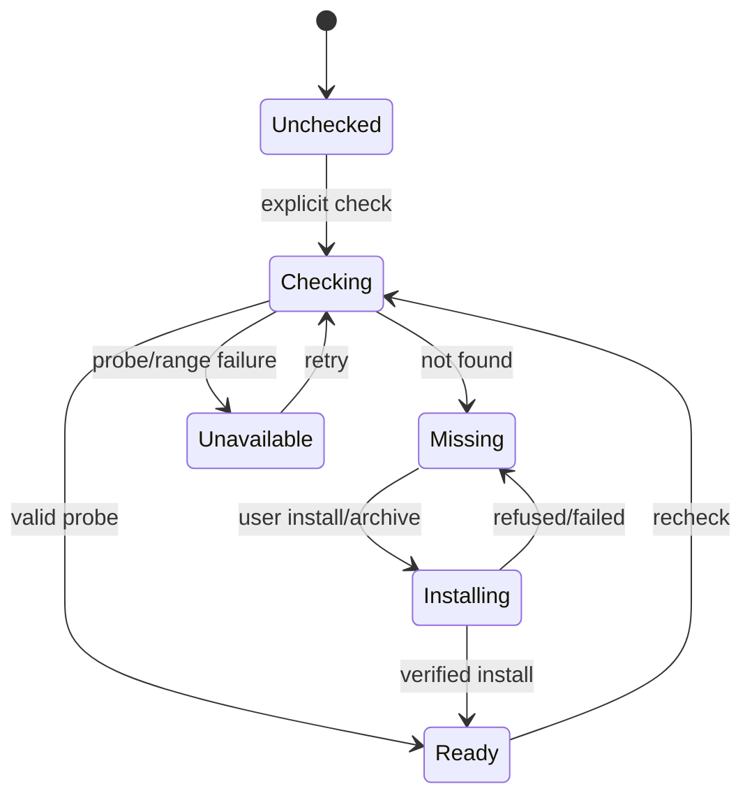

# TASK-5fda967d diagrams

Illustrates Design in TASK-5fda967d.md. Design is authoritative.

Node map: Plugins UI, IPC and Provisioner changed; PluginListingHost/worker added; PluginStore reused unchanged; lightweight session list changed.

## Structure

## Sequence

## State

