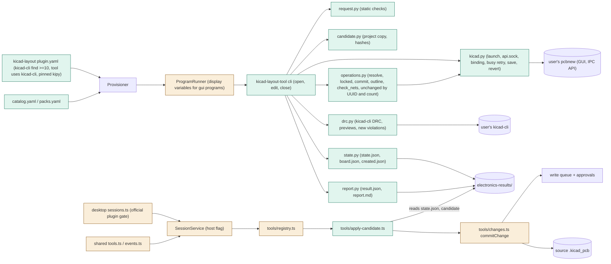
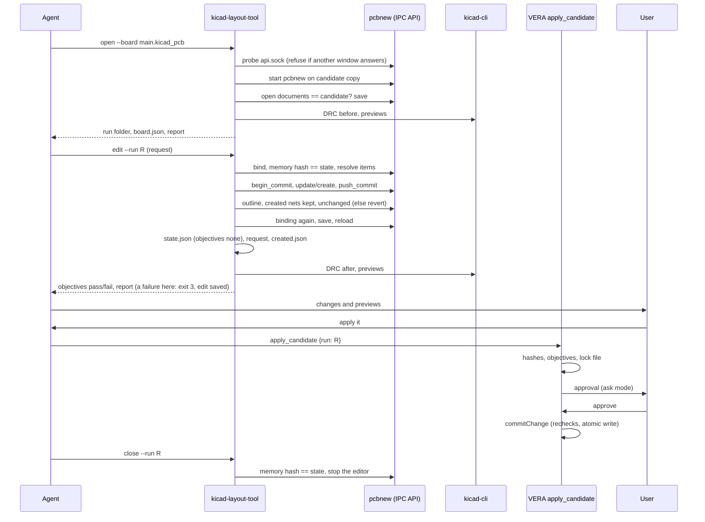
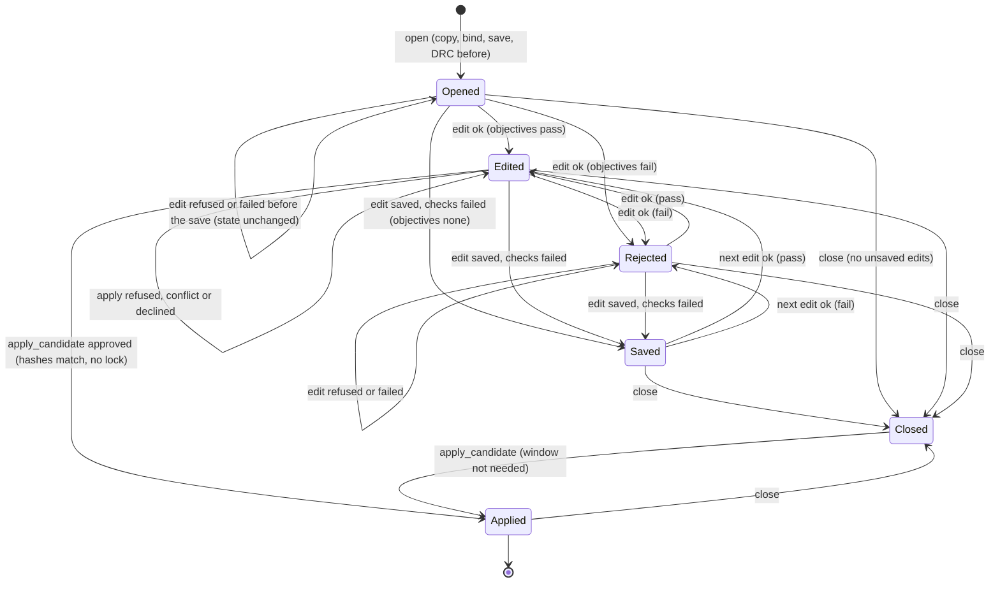

# TASK-6101faa4 diagrams

Illustrates `## Design` in `TASK-6101faa4.md`. The Design text is authoritative.

Node classes: added - kicad-layout plugin manifest, kicad-layout-tool (cli, request, state, candidate, kicad,
operations, drc, report), apply-candidate.ts, catalog/packs entries; changed - changes.ts (commitChange, tool union),
registry.ts, service.ts (host flag), shared tools.ts/events.ts, desktop sessions.ts (gate), renderer labels;
changed in review round 2 - ProgramRunner and program-tools (display variables for `gui: true` programs), shared
plugins.ts (the `gui` field); unchanged - Provisioner, approvals, write queue, the user's KiCad 10 (pcbnew, kicad-cli).

## Structure

## Sequence

## State

