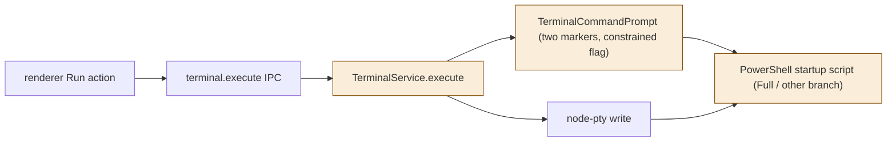
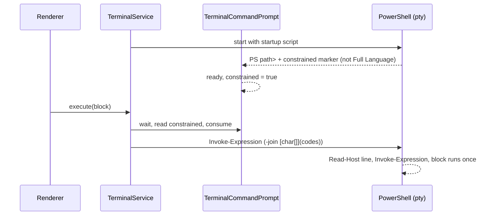
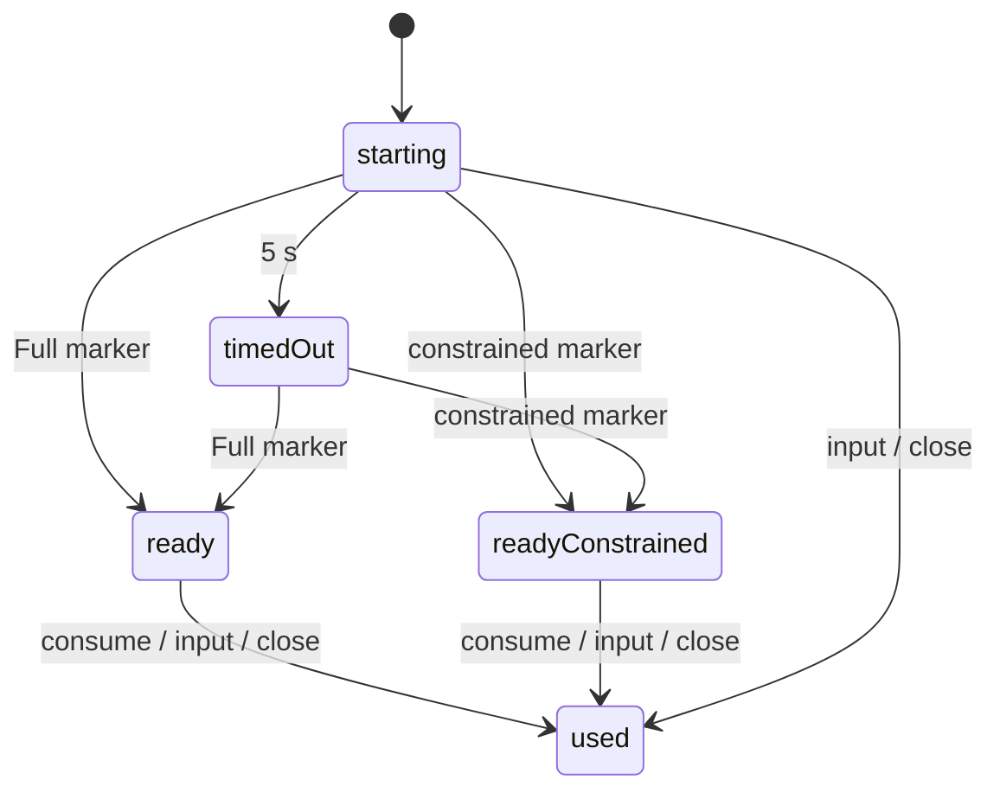

# TASK-617044f6 diagrams

Illustrates `## Design` in `TASK-617044f6.md`. The Design text is authoritative.

Node classes from the Design: changed = PowerShell startup script, TerminalCommandPrompt, TerminalService.execute;
unchanged = renderer Run action, terminal.execute IPC, node-pty.

## Structure

## Sequence

## State

