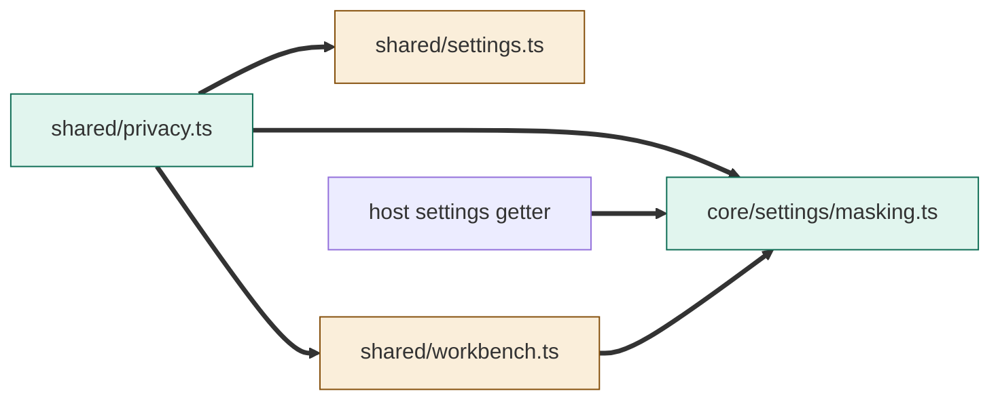

# TASK-6170ebf2 diagrams

Illustrates Design in TASK-6170ebf2.md. Design is authoritative.

## Structure

Node map: privacy.ts and masking.ts added; settings.ts and workbench.ts changed; host getter reused unchanged.

## Sequence

Not drawn: resolver is synchronous in one process; existing persistence flow is unchanged.

## State

Not drawn: no lifecycle or state transitions are added.
