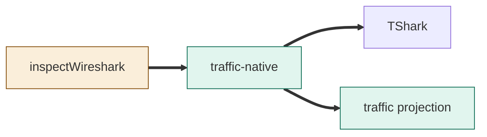
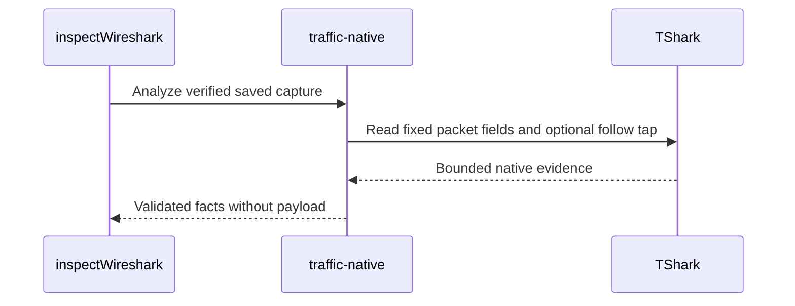

# TASK-61d23d3a diagrams

Illustrates [the task design](TASK-61d23d3a.md).

## Structure

Changed: inspectWireshark. Added: traffic-native and traffic projection. Reused: TShark.

## Sequence

## State

Not drawn because the operations are read-only requests without a new lifecycle.
