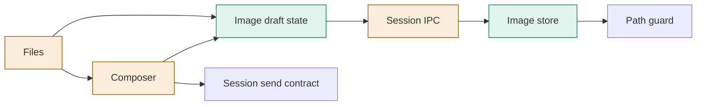
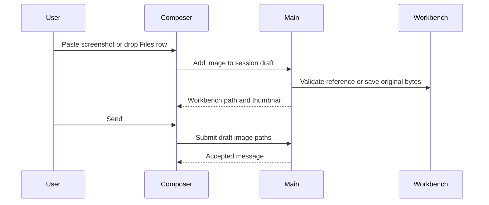
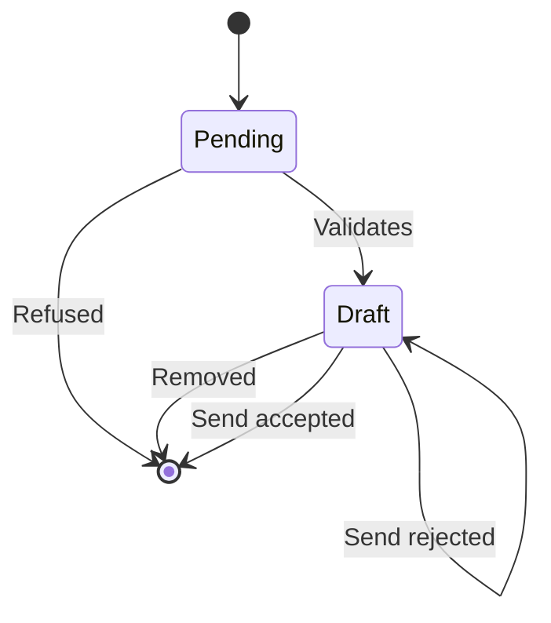

# TASK-61f10b95 diagrams

Illustrates the Design in TASK-61f10b95.md.

## Structure

Added: image draft state and image store. Changed: composer, Files, session IPC. Reused: primary-workbench path guard and existing send contract.

## Sequence

## State

