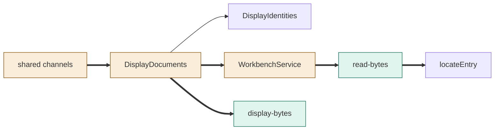
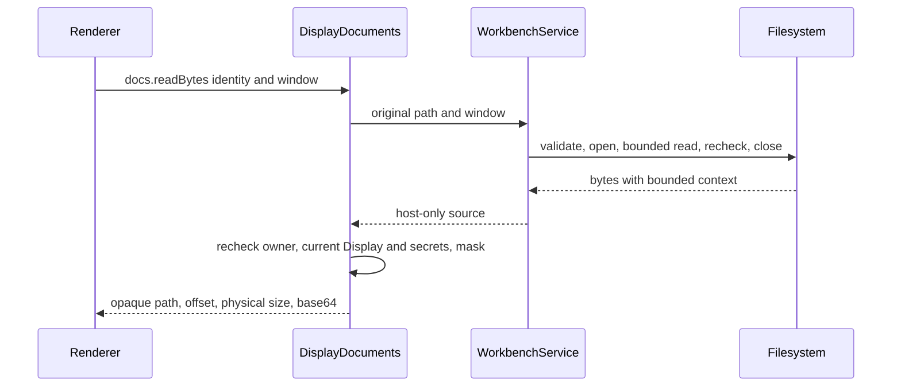

# TASK-64079701 diagrams

Design in TASK-64079701.md is authoritative.

## Structure

Map: shared channels, DisplayDocuments and WorkbenchService changed; read-bytes and display-bytes added;
locateEntry and DisplayIdentities reused unchanged.

## Sequence

## State

Not drawn: no new lifecycle or persisted state transitions.
